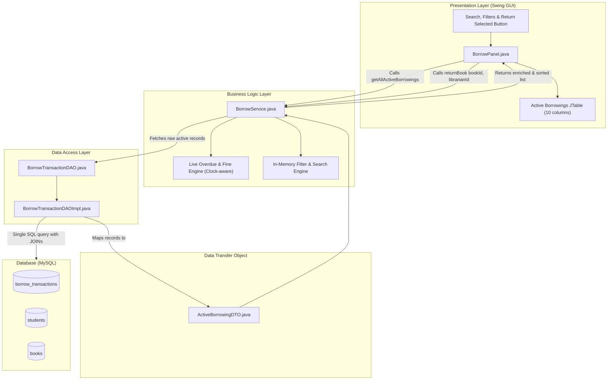
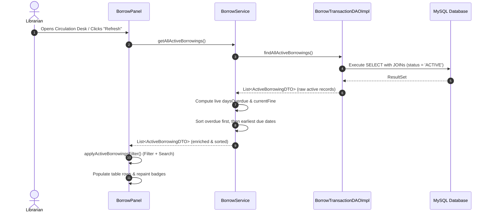
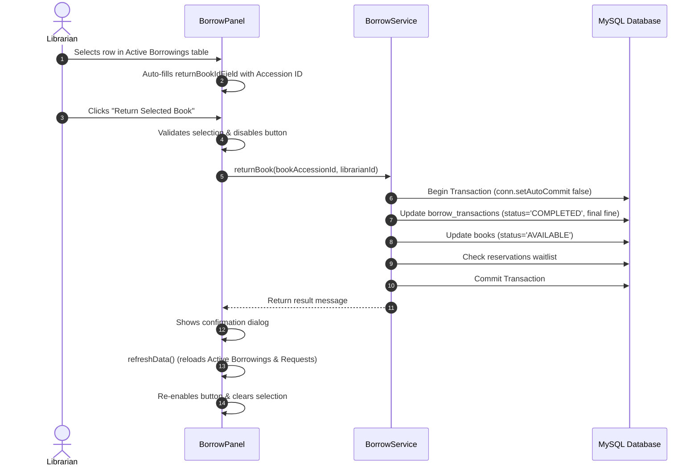

# Active Borrowings Management in SmartLib

## 1. Overview & Objective

The **Active Borrowings Management** feature enhances the College Library Management System (SmartLib) by providing librarians with a centralized, real-time oversight of all currently loaned physical books at the Circulation Desk (`BorrowPanel.java`).

Before this feature, librarians could only issue and return books manually using IDs and process borrow requests, without an overview of outstanding loans, overdue deadlines, or fine accumulations.

The feature seamlessly bridges this gap by introducing:
* A 10-column live inventory table of active borrowings.
* Dynamic, live overdue duration and late fine calculations (₹10/day overdue).
* Priority sorting (overdue books first, earliest upcoming due dates next).
* Multi-criteria search (Student ID, Student Name, Book Accession ID, Book Title).
* Quick status filters (`All Active`, `Overdue`, `Due Today`).
* One-click direct return processing from selected table rows.

---

## 2. Architecture & Component Interaction

The implementation strictly adheres to SmartLib's established **DAO – Service – GUI** architecture.



---

## 3. Layer-by-Layer Breakdown

### A. Data Access Layer (`BorrowTransactionDAO` & `BorrowTransactionDAOImpl`)
* **Method**: `List<ActiveBorrowingDTO> findAllActiveBorrowings() throws LibraryException`
* **Query Design**: Uses a single parameterized SQL query joining `borrow_transactions`, `students`, and `books` to eliminate the $N+1$ query performance problem:
  ```sql
  SELECT bt.id, bt.student_id, s.name AS student_name, bt.book_id, b.title AS book_title,
         bt.issue_date, bt.due_date, bt.status
  FROM borrow_transactions bt
  JOIN students s ON bt.student_id = s.ktu_id
  JOIN books b ON bt.book_id = b.accession_id
  WHERE bt.status = 'ACTIVE'
  ORDER BY bt.due_date ASC, bt.id ASC
  ```
* **Status Filtering**: Restricts results at the database engine level to transactions where `status = 'ACTIVE'`.

### B. Data Transfer Object (`ActiveBorrowingDTO`)
Encapsulates all loan information required by the UI without exposing loose `Object[]` arrays across application layers:
* `int transactionId`
* `String studentId`
* `String studentName`
* `String bookAccessionId`
* `String bookTitle`
* `LocalDate issueDate`
* `LocalDate dueDate`
* `long daysOverdue`
* `double currentFine`
* `String status`

### C. Business Logic Layer (`BorrowService`)
1. **Clock Awareness**: Equipped with an injectable `java.time.Clock` (defaults to system clock). This allows deterministic date-dependent unit testing without relying on system time.
2. **Live Fine Calculation**:
   * If a book's due date is today or in the future: `daysOverdue = 0`, `currentFine = ₹0.00`.
   * If `today > dueDate`:
     $$\text{daysOverdue} = \text{ChronoUnit.DAYS.between}(\text{dueDate}, \text{today})$$
     $$\text{currentFine} = \text{daysOverdue} \times 10.0$$
   * Fines are computed dynamically when the view is fetched or refreshed and are **never** written back to the database until the actual `returnBook()` operation is executed.
3. **Smart Sorting**:
   * Overdue books (`dueDate < today`) are partitioned first, sorted in ascending order of due date (most overdue at the top).
   * Upcoming active loans are placed next, sorted in ascending order of due date (earliest due dates first).
4. **Search and Filter Processing**:
   * `filterActiveBorrowings(List<ActiveBorrowingDTO>, filter, searchQuery)` filters records in-memory without database roundtrips.

### D. GUI Layer (`BorrowPanel`)
1. **Layout & Usability**:
   * Integrated into the librarian's Circulation Desk between Direct Issue/Return cards and the Pending Borrow Requests table.
   * Contained inside a smooth vertical scroll pane, guaranteeing clear readability without obscuring controls on 1024×680 and 920×600 window dimensions.
2. **10-Column Table**:
   * Styled using `UITheme.styleTable()`.
   * Displays pill-shaped status badges for `ACTIVE` status.
   * Formats fines with currency symbol: `String.format("₹%.2f", fine)`.
3. **Empty States**:
   * Custom-painted placeholder labels centered in the table viewport:
     * `"No active borrowings found."` (when library has no active loans).
     * `"No active borrowings match the selected filter."` (when current filter/search yields zero rows).
4. **Selection Interactivity**:
   * Selecting a row synchronizes the physical book accession ID to the manual return field and enables one-click returning.
   * Table selection is mutually exclusive with the Pending Borrow Requests table. Clicking outside deselects any highlighted row.

---

## 4. End-to-End Workflow & How It Works

### Flow 1: Loading & Viewing Active Borrowings


### Flow 2: Returning an Issued Book Directly from the Table


---

## 5. Search & Filter Rules

| Filter Option | Criteria | Target Rows |
| :--- | :--- | :--- |
| **All Active** | All transactions with `status = 'ACTIVE'` | Entire active loan roster |
| **Overdue** | `dueDate != null && dueDate < today` | Books past their 14-day borrowing deadline |
| **Due Today** | `dueDate != null && dueDate == today` | Books that must be returned today |

**Search Field**:
* Matches case-insensitively across 4 attributes simultaneously:
  1. Student KTU ID (e.g. `TVE23CS001`)
  2. Student Name (e.g. `Alice Smith`)
  3. Book Accession ID (e.g. `B1003`)
  4. Book Title (e.g. `Domain-Driven Design`)

---

## 6. Verification and Testing Coverage

The feature is verified with unit tests covering 10 distinct scenarios in `BorrowServiceTest.java`:

1. **Retrieving all active borrowings**: Verifies DAO retrieval and model binding.
2. **Excluding completed transactions**: Ensures only `ACTIVE` transactions are exposed.
3. **Resolving student names & book titles**: Ensures relational join attributes map accurately.
4. **Zero fine on due date**: Asserts `daysOverdue == 0` and `fine == ₹0.00` on the due date.
5. **₹10 fine for one overdue day**: Asserts `daysOverdue == 1` and `fine == ₹10.00`.
6. **₹30 fine for three overdue days**: Asserts `daysOverdue == 3` and `fine == ₹30.00`.
7. **Filter & search evaluation**: Asserts accurate partitioning for `Overdue`, `Due Today`, `All Active`, and search queries.
8. **Successful return removal**: Asserts that returning a book moves it to `COMPLETED` and removes it from subsequent active listings.
9. **Defensive rollback on failure**: Asserts error conditions don't corrupt transaction or book states.
10. **Empty-state handling**: Asserts graceful behavior when no active records exist.
