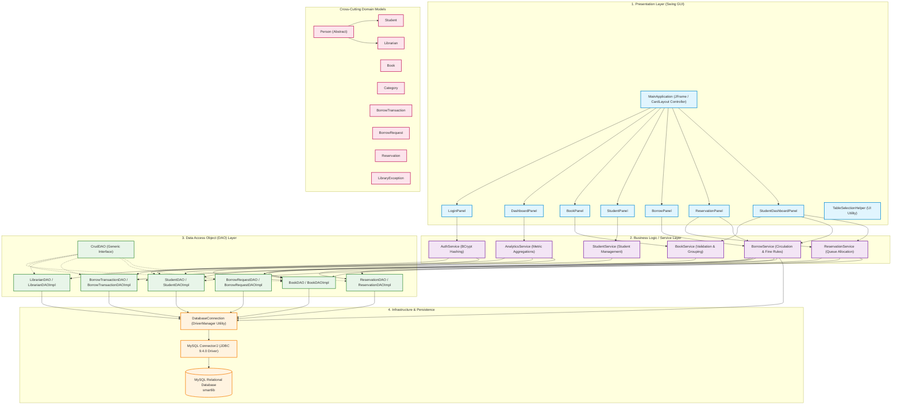
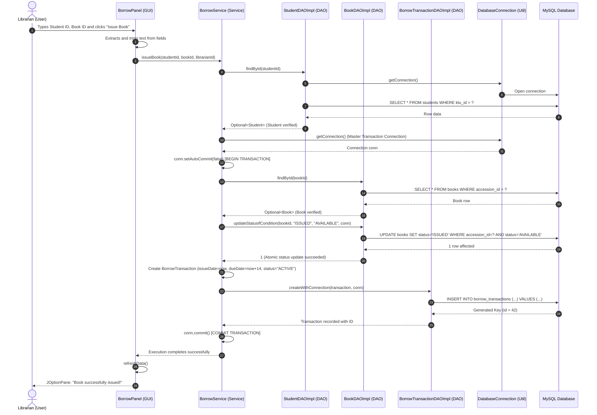
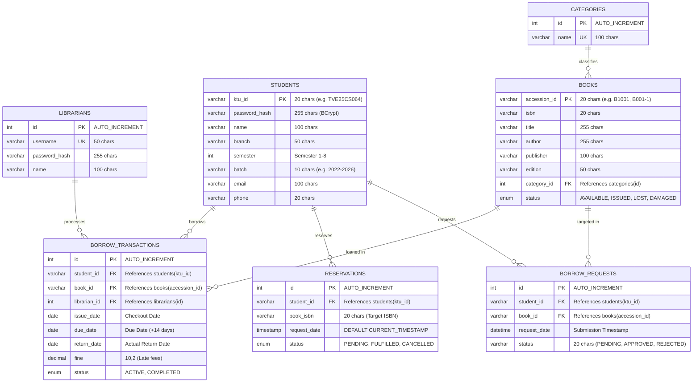

# SmartLib: Comprehensive College Library Management System Teaching Guide

> **Target Audience**: Students and developers learning Java, Object-Oriented Programming (OOP), Swing GUI, JDBC, MySQL, Maven, and Git.  
> **Repository**: `SmartLib` (College Library Management System)  
> **Source-of-Truth**: Verified directly against repository source code, build manifests, and active database schemas.

---

## Table of Contents

1. [Executive Summary & Plain Language Overview](#1-executive-summary--plain-language-overview)
   - [What SmartLib Is and What It Does](#what-smartlib-is-and-what-it-does)
   - [Target Users and Real-World Problems Solved](#target-users-and-real-world-problems-solved)
   - [Application Type and Architecture Category](#application-type-and-architecture-category)
   - [Application Startup Flow](#application-startup-flow)
   - [Data Storage Strategy & MySQL Dependency](#data-storage-strategy--mysql-dependency)
   - [Connected vs. Disconnected Behavior](#connected-vs-disconnected-behavior)
   - [Verified Technology Stack & Dependency Matrix](#verified-technology-stack--dependency-matrix)
2. [Complete Project Folder Structure & File Map](#2-complete-project-folder-structure--file-map)
   - [Repository Directory Tree](#repository-directory-tree)
   - [Exhaustive File-by-File Breakdown](#exhaustive-file-by-file-breakdown)
3. [System Architecture & Information Data Flow](#3-system-architecture--information-data-flow)
   - [Verified Multi-Tier Architecture](#verified-multi-tier-architecture)
   - [Architectural Flow Diagram (Mermaid)](#architectural-flow-diagram-mermaid)
   - [Layer Responsibilities & Separation of Concerns](#layer-responsibilities--separation-of-concerns)
   - [End-to-End Request-Response Data Trace](#end-to-end-request-response-data-trace)
   - [Architectural Reality vs. Monolithic Assumptions](#architectural-reality-vs-monolithic-assumptions)
4. [Complete Java Class & Interface Reference](#4-complete-java-class--interface-reference)
   - [Master Class and Interface Directory](#master-class-and-interface-directory)
   - [Domain Models (Entity Layer)](#domain-models-entity-layer)
   - [Data Access Object (DAO) Layer](#data-access-object-dao-layer)
   - [Business Logic & Service Layer](#business-logic--service-layer)
   - [Graphical User Interface (GUI) Components](#graphical-user-interface-gui-components)
   - [Infrastructure, Utilities, and Exceptions](#infrastructure-utilities-and-exceptions)
   - [Detailed Walkthrough of Critical Methods](#detailed-walkthrough-of-critical-methods)
5. [Object-Oriented Programming (OOP) Concepts in Action](#5-object-oriented-programming-oop-concepts-in-action)
   - [Classes and Objects](#classes-and-objects)
   - [Encapsulation & Information Hiding](#encapsulation--information-hiding)
   - [Abstraction & Interface Segregation](#abstraction--interface-segregation)
   - [Inheritance Hierarchies](#inheritance-hierarchies)
   - [Polymorphism (Dynamic & Static)](#polymorphism-dynamic--static)
   - [Method Overriding vs. Method Overloading](#method-overriding-vs-method-overloading)
   - [Composition, Aggregation, and Association](#composition-aggregation-and-association)
   - [Constructor Design & Chaining](#constructor-design--chaining)
   - [Exception Handling Architecture](#exception-handling-architecture)
   - [Enumerations & Type Mapping Divergences](#enumerations--type-mapping-divergences)
   - [SOLID Principles in the Codebase](#solid-principles-in-the-codebase)
6. [Database Design, Relational Schema, and Data Modeling](#6-database-design-relational-schema-and-data-modeling)
   - [Database Name & Engine Configuration](#database-name--engine-configuration)
   - [Entity-Relationship (ER) Diagram (Mermaid)](#entity-relationship-er-diagram-mermaid)
   - [Detailed Table Catalogs & Constraints](#detailed-table-catalogs--constraints)
   - [Accession ID vs. ISBN vs. Database ID vs. Borrow Transaction](#accession-id-vs-isbn-vs-database-id-vs-borrow-transaction)
   - [Seed Data & Initial Development State](#seed-data--initial-development-state)
   - [Object-Relational Mapping (ORM) Matrix](#object-relational-mapping-orm-matrix)
   - [Verified Schema Mismatches & Technical Quirks](#verified-schema-mismatches--technical-quirks)
7. [Database Connectivity, JDBC Internals, and Configuration](#7-database-connectivity-jdbc-internals-and-configuration)
   - [Database Setup & Script Execution Sequence](#database-setup--script-execution-sequence)
   - [JDBC Driver Integration via Maven](#jdbc-driver-integration-via-maven)
   - [Configuration Management (`database.properties`)](#configuration-management-databaseproperties)
   - [The `DatabaseConnection` Factory](#the-databaseconnection-factory)
   - [Step-by-Step Anatomy of a JDBC Operation](#step-by-step-anatomy-of-a-jdbc-operation)
   - [Transaction Management and ACID Guarantees](#transaction-management-and-acid-guarantees)
   - [Security Practices & Credential Masking](#security-practices--credential-masking)
8. [End-to-End Application Workflows](#8-end-to-end-application-workflows)
   - [Workflow 1: Application Startup & View Routing](#workflow-1-application-startup--view-routing)
   - [Workflow 2: Librarian Authentication](#workflow-2-librarian-authentication)
   - [Workflow 3: Student Registration & Authentication](#workflow-3-student-registration--authentication)
   - [Workflow 4: Cataloging a New Book](#workflow-4-cataloging-a-new-book)
   - [Workflow 5: Enrolling a Student (Admin Side)](#workflow-5-enrolling-a-student-admin-side)
   - [Workflow 6: Manual Book Issue & Concurrency Safeguard](#workflow-6-manual-book-issue--concurrency-safeguard)
   - [Workflow 7: Book Return, Late Fine Calculation, and Reservation Queue Notification](#workflow-7-book-return-late-fine-calculation-and-reservation-queue-notification)
   - [Workflow 8: Title Reservation & Priority Queue Fulfilment](#workflow-8-title-reservation--priority-queue-fulfilment)
   - [Workflow 9: Student Borrow Request Workflow (Request -> Approval/Rejection)](#workflow-9-student-borrow-request-workflow-request---approvalrejection)
   - [Workflow 10: Student Clearance & Outstanding Dues Verification](#workflow-10-student-clearance--outstanding-dues-verification)
   - [Workflow 11: Real-Time Book Catalog Search & Aggregation](#workflow-11-real-time-book-catalog-search--aggregation)
9. [Graphical User Interface (Swing & AWT) Architecture](#9-graphical-user-interface-swing--awt-architecture)
   - [Roles of Swing (`javax.swing`) vs. AWT (`java.awt`)](#roles-of-swing-javaxswing-vs-awt-javaawt)
   - [Main Application Window (`MainApplication`) & CardLayout Navigation](#main-application-window-mainapplication--cardlayout-navigation)
   - [The Screen Roster & Panel Breakdown](#the-screen-roster--panel-breakdown)
   - [Custom Table Selection & Deselection Management (`TableSelectionHelper`)](#custom-table-selection--deselection-management-tableselectionhelper)
   - [Table Model Data Binding & UI Refresh Cycles](#table-model-data-binding--ui-refresh-cycles)
   - [User Notification & Error Dialog Strategy](#user-notification--error-dialog-strategy)
10. [Building, Running, and Debugging Guide](#10-building-running-and-debugging-guide)
    - [System Prerequisites](#system-prerequisites)
    - [Step-by-Step Setup from Scratch](#step-by-step-setup-from-scratch)
    - [Running via IntelliJ IDEA or IDE of Choice](#running-via-intellij-idea-or-ide-of-choice)
    - [Command-Line Execution via Maven Wrapper](#command-line-execution-via-maven-wrapper)
    - [Exhaustive Troubleshooting Matrix](#exhaustive-troubleshooting-matrix)
11. [Safe Extension & Code Modification Guide](#11-safe-extension--code-modification-guide)
    - [Layered Modification Protocol](#layered-modification-protocol)
    - [Recipe 1: Add a Field to the Student Entity](#recipe-1-add-a-field-to-the-student-entity)
    - [Recipe 2: Add an Attribute to the Book Entity](#recipe-2-add-an-attribute-to-the-book-entity)
    - [Recipe 3: Add a New Database Column](#recipe-3-add-a-new-database-column)
    - [Recipe 4: Add a New Button to a Panel](#recipe-4-add-a-new-button-to-a-panel)
    - [Recipe 5: Add a New DAO Query Method](#recipe-5-add-a-new-dao-query-method)
    - [Recipe 6: Modify Business Policies (Loan Period & Fine Rate)](#recipe-6-modify-business-policies-loan-period--fine-rate)
    - [Recipe 7: Add a Dedicated Student Clearance Panel](#recipe-7-add-a-dedicated-student-clearance-panel)
12. [Testing Assessment, Manual Checklist, and Known Limitations](#12-testing-assessment-manual-checklist-and-known-limitations)
    - [Evaluation of Existing Automated Tests](#evaluation-of-existing-automated-tests)
    - [Test Coverage Gaps](#test-coverage-gaps)
    - [Comprehensive Manual Test Checklist](#comprehensive-manual-test-checklist)
    - [Verified System Limitations & Known Quirks](#verified-system-limitations--known-quirks)
13. [Academic Viva Voce Preparation & Rapid Learning Roadmap](#13-academic-viva-voce-preparation--rapid-learning-roadmap)
    - [25 Real-World Viva Questions with Model Answers](#25-real-world-viva-questions-with-model-answers)
    - [Structured Two-Session Study Plan](#structured-two-session-study-plan)
    - [Code-Reading Sequence Roadmap](#code-reading-sequence-roadmap)
    - [Comprehensive Technical Glossary](#comprehensive-technical-glossary)

---

## 1. Executive Summary & Plain Language Overview

### What SmartLib Is and What It Does

**SmartLib** is a standalone, client-server desktop application written in Java. It functions as a complete **College Library Management System (CLMS)** designed to manage the circulation of physical textbooks, student records, catalog inventories, borrowing transactions, waitlist reservations, and digital borrow requests in an academic institution.

The application bridges two distinct operational workflows through a single graphical user interface:
1. **Administrative Librarian Portal**: Enables library staff to manage the physical book catalog, enroll students, issue and return books manually, compute overdue fines, manage reservations, approve/reject digital borrowing requests, and view real-time inventory statistics.
2. **Student Self-Service Portal**: Allows enrolled college students (identified by their university KTU ID) to authenticate securely, browse and search available book titles grouped by ISBN, view available copy counts, submit digital borrow requests, track issued books and past borrowing history, and monitor waitlist reservations in real time.

### Target Users and Real-World Problems Solved

In typical collegiate libraries, manual ledger records or disjointed spreadsheets lead to lost copies, uncollected late fees, duplicate issue conflicts, and long queues at circulation counters. SmartLib addresses these pain points for two key user roles:

| User Role | Responsibilities & Activities | Core Problems Solved by SmartLib |
|---|---|---|
| **Librarian / Staff** | Catalog books, register students, issue books, process returns, compute fines, manage reservations, approve requests. | Eliminates manual register entry errors; prevents issuing already-borrowed books through atomic database transactions; calculates daily overdue fines automatically; alerts staff immediately when a returned book has a pending waitlist reservation. |
| **College Student** | Search textbook catalog, verify available physical copies, request book loans online, monitor personal loan due dates. | Eliminates unnecessary physical trips to check shelf availability; allows transparent tracking of personal loan due dates to avoid fines; provides a queue-based reservation system for high-demand titles. |

### Application Type and Architecture Category

- **Application Type**: **Java Desktop Application** built using **Java Swing** (`javax.swing`) for UI components and **Java Abstract Window Toolkit (AWT)** (`java.awt`) for layout management and native windowing events.
- **Architectural Style**: **Layered / Multi-Tier Desktop Client-Server Architecture**. The application executes locally on the user's desktop machine and connects via Java Database Connectivity (JDBC) over a local network or localhost TCP/IP connection to a **MySQL Relational Database Management System (RDBMS)**.
- **Not a Web or Mobile Application**: SmartLib has no embedded HTTP web server (such as Tomcat, Jetty, or Spring Boot), no HTML/CSS frontend, and no REST API endpoints. It runs directly on the Java Virtual Machine (JVM).

### Application Startup Flow

When the program is launched:
1. The JVM invokes `com.college.library.gui.MainApplication.main(String[] args)`.
2. The entry point hands UI creation to the **AWT Event Dispatch Thread (EDT)** using `SwingUtilities.invokeLater(...)`.
3. In `MainApplication`, `initServices()` instantiates all concrete DAO implementations (`BookDAOImpl`, `StudentDAOImpl`, `LibrarianDAOImpl`, `BorrowTransactionDAOImpl`, `BorrowRequestDAOImpl`, `ReservationDAOImpl`) and injects them into the service layer classes (`AuthService`, `BookService`, `StudentService`, `BorrowService`, `ReservationService`, `AnalyticsService`).
4. `initUI()` configures the main `JFrame` window (dimensions $800 \times 600$, centered, `EXIT_ON_CLOSE`), initializes all seven screen panels, mounts them into a container managed by a `CardLayout`, and displays the `"LOGIN"` card (`LoginPanel`).
5. The user is presented with the dual-panel login screen: Librarian Login on top and Student Login/Registration below.

### Data Storage Strategy & MySQL Dependency

- **Persistent Data Store**: Data is stored permanently in a **MySQL** database named `smartlib`.
- **Relational Tables**: The system maintains seven relational tables: `librarians`, `students`, `categories`, `books`, `borrow_transactions`, `reservations`, and `borrow_requests`.
- **State in Memory**: Java objects (`Book`, `Student`, `Librarian`, `BorrowTransaction`, etc.) serve as transient, in-memory representations of individual table rows. No persistent data is saved into local JSON, XML, or flat files.

### Connected vs. Disconnected Behavior

SmartLib is designed strictly as an **online database client**. It does **not** provide an offline cache or fallback in-memory SQLite/H2 engine:

- **When Connected to MySQL**: The application executes queries, fetches records, updates book statuses, and commits ACID transactions smoothly.
- **When MySQL is Disconnected or Offline**:
  - `DatabaseConnection.getConnection()` attempts to open a socket connection to `jdbc:mysql://localhost:3306/smartlib`.
  - If MySQL is stopped or unreachable, the driver throws a `java.sql.SQLException` (such as `CommunicationsException: Communications link failure`).
  - The DAO layer catches this exception and wraps it in a domain-specific `com.college.library.exception.LibraryException`.
  - The Service and GUI layers catch the `LibraryException` and trigger a `JOptionPane.showMessageDialog` informing the user that the operation failed.
  - The GUI does not crash or terminate; it remains open, but all data operations (login, search, table loading, issuing, returning) fail gracefully with error popups until MySQL is restored.

### Verified Technology Stack & Dependency Matrix

All versions and artifacts below are verified directly from `pom.xml`, the Maven Wrapper configuration, and project source code:

| Technology / Library | GroupId / ArtifactId | Exact Version | Repository Role & Purpose | Where Used in Codebase |
|---|---|---|---|---|
| **Java Platform (JDK)** | Native Oracle OpenJDK / Adoptium | **17 (LTS)** | Base programming language and runtime environment (`<maven.compiler.source>17</maven.compiler.source>`). | Entire project across `src/main/java` and `src/test/java`. |
| **MySQL Connector/J** | `com.mysql:mysql-connector-j` | **9.4.0** | Official JDBC Type 4 driver facilitating network communication between Java and MySQL Server. | `DatabaseConnection.java`, all DAO implementations in `dao/impl/`. |
| **jBCrypt** | `org.mindrot:jbcrypt` | **0.4** | Adaptive password hashing utility utilizing the Blowfish-based BCrypt key derivation function (12 salt rounds). | `AuthService.java`, `BCryptTest.java`, `StudentAuthTest.java`. |
| **JUnit Jupiter API** | `org.junit.jupiter:junit-jupiter-api` | **5.10.0** | Unit testing framework API for defining test cases, setup lifecycle hooks (`@BeforeEach`), and assertions (`assertEquals`, `assertThrows`). | All test classes in `src/test/java/com/college/library/`. |
| **JUnit Jupiter Engine** | `org.junit.jupiter:junit-jupiter-engine` | **5.10.0** | Execution engine running JUnit 5 tests via Maven Surefire plugin. | Test runtime test execution via Maven. |
| **Apache Maven** | Maven Wrapper (`mvnw`, `mvnw.cmd`) | **3.9.x Wrapper** | Build automation tool, dependency manager, compiler runner, and test executor. | Root files `pom.xml`, `mvnw`, `mvnw.cmd`, `.mvn/`. |
| **Java Swing** | `javax.swing.*` (JDK standard library) | Java 17 Built-in | GUI toolkit providing lightweight visual controls (`JFrame`, `JPanel`, `JButton`, `JTable`, `JTextField`, `JPasswordField`, `JOptionPane`). | All classes in package `com.college.library.gui.*`. |
| **Java AWT** | `java.awt.*`, `java.awt.event.*` (JDK built-in) | Java 17 Built-in | Underpinning windowing layouts (`CardLayout`, `BorderLayout`, `GridLayout`, `GridBagLayout`, `FlowLayout`, `BoxLayout`) and mouse/action events. | All classes in package `com.college.library.gui.*`. |
| **Git** | Source Control System | Repository standard | Tracks source code revision history, feature branches, and merges across team members. | Root `.git/`, `.gitignore`. |

---

## 2. Complete Project Folder Structure & File Map

### Repository Directory Tree

The following directory tree reflects the exact files tracked in the repository:

```
SmartLib/
├── .gitignore                                 # Git ignore definitions for builds, IDEs, and local credentials
├── .mvn/
│   └── wrapper/
│       └── maven-wrapper.properties           # Defines Maven distribution URL for the wrapper
├── README.md                                  # High-level overview and Windows setup instructions
├── build.ps1                                  # Helper PowerShell script for JDK detection and compilation
├── mvnw                                       # Unix/Linux POSIX shell script for Maven Wrapper
├── mvnw.cmd                                   # Windows Command script for Maven Wrapper
├── mvnwDebug                                  # Unix/Linux shell script for Maven Wrapper in debug mode
├── mvnwDebug.cmd                              # Windows Command script for Maven Wrapper in debug mode
├── pom.xml                                    # Maven Project Object Model (dependencies, compiler level)
├── src/
│   ├── main/
│   │   ├── java/
│   │   │   └── com/
│   │   │       └── college/
│   │   │           └── library/
│   │   │               ├── dao/
│   │   │               │   ├── BookDAO.java
│   │   │               │   ├── BorrowRequestDAO.java
│   │   │               │   ├── BorrowTransactionDAO.java
│   │   │               │   ├── CrudDAO.java
│   │   │               │   ├── LibrarianDAO.java
│   │   │               │   ├── ReservationDAO.java
│   │   │               │   └── StudentDAO.java
│   │   │               │   └── impl/
│   │   │               │       ├── BookDAOImpl.java
│   │   │               │       ├── BorrowRequestDAOImpl.java
│   │   │               │       ├── BorrowTransactionDAOImpl.java
│   │   │               │       ├── LibrarianDAOImpl.java
│   │   │               │       ├── ReservationDAOImpl.java
│   │   │               │       └── StudentDAOImpl.java
│   │   │               ├── exception/
│   │   │               │   └── LibraryException.java
│   │   │               ├── gui/
│   │   │               │   ├── BookPanel.java
│   │   │               │   ├── BorrowPanel.java
│   │   │               │   ├── DashboardPanel.java
│   │   │               │   ├── LoginPanel.java
│   │   │               │   ├── MainApplication.java
│   │   │               │   ├── ReservationPanel.java
│   │   │               │   ├── StudentDashboardPanel.java
│   │   │               │   ├── StudentPanel.java
│   │   │               │   └── TableSelectionHelper.java
│   │   │               ├── model/
│   │   │               │   ├── Book.java
│   │   │               │   ├── BorrowRequest.java
│   │   │               │   ├── BorrowTransaction.java
│   │   │               │   ├── Category.java
│   │   │               │   ├── Librarian.java
│   │   │               │   ├── Person.java
│   │   │               │   ├── Reservation.java
│   │   │               │   └── Student.java
│   │   │               ├── service/
│   │   │               │   ├── AnalyticsService.java
│   │   │               │   ├── AuthService.java
│   │   │               │   ├── BookService.java
│   │   │               │   ├── BorrowService.java
│   │   │               │   ├── ReservationService.java
│   │   │               │   └── StudentService.java
│   │   │               └── util/
│   │   │                   └── DatabaseConnection.java
│   │   └── resources/
│   │       ├── database.properties.example    # Configuration template for MySQL connection properties
│   │       ├── sample_data.sql                # Seed data for default accounts, categories, and initial books
│   │       └── schema.sql                     # Full MySQL DDL script creating all seven core tables
│   └── test/
│       └── java/
│           └── com/
│               └── college/
│                   └── library/
│                       ├── BCryptTest.java
│                       └── service/
│                           ├── AuthServiceTest.java
│                           ├── BookServiceTest.java
│                           ├── BorrowServiceTest.java
│                           └── StudentAuthTest.java
```

### Exhaustive File-by-File Breakdown

#### Root Configuration and Scripts

- **`pom.xml`**
  - **Relative Path**: `pom.xml`
  - **Contents**: Declarative Maven XML build file defining project coordinates (`com.college.library:SmartLib:1.0-SNAPSHOT`), compiler source/target versions (`17`), and four dependencies (`mysql-connector-j`, `jbcrypt`, `junit-jupiter-api`, `junit-jupiter-engine`).
  - **Why It Exists**: Central build descriptor used by Maven to download libraries, compile source code, and run test suites.
  - **Used By**: Maven command-line tool, IDE project importers (IntelliJ, Eclipse, VS Code).
  - **When to Edit**: When adding new libraries, updating dependencies, changing the Java compiler target version, or configuring build plugins.

- **`README.md`**
  - **Relative Path**: `README.md`
  - **Contents**: Markdown document containing an overview of SmartLib, setup instructions for Windows environments (JDK 17, MySQL Server), default login credentials, and troubleshooting hints.
  - **Why It Exists**: Quick onboarding guide for developers setting up the application for the first time.
  - **Used By**: Human developers and repository visitors.
  - **When to Edit**: When modifying setup procedures, system requirements, or default user credentials.

- **`build.ps1`**
  - **Relative Path**: `build.ps1`
  - **Contents**: PowerShell helper script that scans `C:\Program Files\Java` for an installed JDK directory, sets the `JAVA_HOME` environment variable, and invokes `.\mvnw.cmd clean compile`.
  - **Why It Exists**: Convenience script for Windows developers whose `JAVA_HOME` is not permanently configured in system environment variables.
  - **Used By**: Windows PowerShell users.
  - **When to Edit**: If custom build routines or test execution steps need to be automated on Windows.

- **`mvnw`, `mvnw.cmd`, `mvnwDebug`, `mvnwDebug.cmd`, `.mvn/wrapper/maven-wrapper.properties`**
  - **Relative Path**: `.mvn/wrapper/maven-wrapper.properties`, `mvnw*`
  - **Contents**: Maven Wrapper binaries and scripts that automatically download and run the appropriate version of Apache Maven without requiring a prior system-wide Maven installation.
  - **Why It Exists**: Guarantees consistent build behavior across different developer machines and operating systems.
  - **Used By**: Developers executing builds via `./mvnw` (Linux/macOS) or `.\mvnw.cmd` (Windows).
  - **When to Edit**: Rarely edited; modified only when upgrading the underlying Maven wrapper version.

- **`.gitignore`**
  - **Relative Path**: `.gitignore`
  - **Contents**: Patterns excluding build artifacts (`target/`, `*.class`, `*.jar`), IDE configuration directories (`.idea/`, `*.iml`, `.vscode/`), log files, and sensitive credentials (`database.properties`, `*.env`).
  - **Why It Exists**: Prevents committing compiled binaries and local database passwords to public source control.
  - **Used By**: Git version control engine.
  - **When to Edit**: When introducing new local configuration files or tool-specific artifact directories that should not be tracked.

#### Database Scripts and Configuration Resources (`src/main/resources`)

- **`src/main/resources/database.properties.example`**
  - **Contents**: Template file showing the three key-value pairs required for MySQL connectivity: `db.url=jdbc:mysql://localhost:3306/smartlib`, `db.user=root`, and `db.password=root`.
  - **Why It Exists**: Serves as a clean blueprint for creating the active `database.properties` configuration file without exposing actual database passwords in Git.
  - **Used By**: Developers during repository setup.
  - **When to Edit**: If the database connection parameter keys change (e.g., adding connection pool sizing properties).

- **`src/main/resources/schema.sql`**
  - **Contents**: Data Definition Language (DDL) script containing `CREATE TABLE IF NOT EXISTS` statements for all seven database tables: `librarians`, `students`, `categories`, `books`, `borrow_transactions`, `reservations`, and `borrow_requests`. Includes primary keys, foreign keys, unique constraints, and enum types.
  - **Why It Exists**: Establishes the authoritative relational schema structure in MySQL.
  - **Used By**: MySQL database administrator or developer during initial database setup.
  - **When to Edit**: Whenever altering table structures, adding columns, modifying foreign key cascades, or introducing new database constraints.

- **`src/main/resources/sample_data.sql`**
  - **Contents**: Data Manipulation Language (DML) script containing sample seed data: one administrator librarian (`admin` with a BCrypt hash), three book categories (`Computer Science`, `Mathematics`, `Physics`), three sample books (`B1001`, `B1002`, `B1003`), sample students, an active borrow transaction, and a pending reservation.
  - **Why It Exists**: Populates a freshly initialized database with test records so features can be demonstrated and tested immediately.
  - **Used By**: Developers initializing demo environments.
  - **When to Edit**: When adding realistic demo datasets or updating seed accounts.

#### Entity / Domain Model Layer (`src/main/java/.../model`)

- **`Person.java`**
  - **Relative Path**: `src/main/java/com/college/library/model/Person.java`
  - **Contents**: Abstract base class defining common personal attributes: `name`, `email`, and `phone` with standard getters and setters.
  - **Why It Exists**: Implements core OOP abstraction and inheritance, serving as the common ancestor for human actors in the library system.
  - **Used By**: `Student.java`, `Librarian.java`.
  - **When to Edit**: When adding personal contact attributes applicable to all individuals (e.g., `address`, `nationalId`).

- **`Student.java`**
  - **Relative Path**: `src/main/java/com/college/library/model/Student.java`
  - **Contents**: Concrete class extending `Person`. Adds collegiate attributes: `ktuId`, `passwordHash`, `branch`, `semester`, and `batch`.
  - **Why It Exists**: Models student patrons who borrow books, reserve titles, and log into the student portal.
  - **Used By**: `StudentDAO`, `StudentDAOImpl`, `StudentService`, `AuthService`, `StudentPanel`, `StudentDashboardPanel`, `BorrowService`, `ReservationService`.
  - **When to Edit**: When expanding student demographic data or tracking academic status.

- **`Librarian.java`**
  - **Relative Path**: `src/main/java/com/college/library/model/Librarian.java`
  - **Contents**: Concrete class extending `Person`. Adds authentication and staff attributes: integer surrogate `id`, `username`, and `passwordHash`. Passes `name` to `super(name, null, null)`.
  - **Why It Exists**: Models authorized library staff members who log into the administrative dashboard.
  - **Used By**: `LibrarianDAO`, `LibrarianDAOImpl`, `AuthService`, `LoginPanel`, `MainApplication`, `BorrowPanel`.
  - **When to Edit**: When adding staff roles (e.g., `role`, `shiftSchedule`).

- **`Book.java`**
  - **Relative Path**: `src/main/java/com/college/library/model/Book.java`
  - **Contents**: Domain entity representing an individual physical book copy. Contains: `accessionId` (unique copy ID), `isbn`, `title`, `author`, `publisher`, `edition`, `categoryId`, and `status` (`AVAILABLE`, `ISSUED`, `LOST`, `DAMAGED`).
  - **Why It Exists**: Central entity representing items in the library catalog.
  - **Used By**: `BookDAO`, `BookDAOImpl`, `BookService`, `BookPanel`, `BorrowService`, `StudentDashboardPanel`.
  - **When to Edit**: When adding cataloging metadata such as publication year, shelf rack location, or price.

- **`Category.java`**
  - **Relative Path**: `src/main/java/com/college/library/model/Category.java`
  - **Contents**: Lightweight lookup entity with fields `id` and `name`. Overrides `toString()` to return `name`.
  - **Why It Exists**: Represents thematic book classifications (`Computer Science`, `Physics`, etc.) and renders user-friendly text in Swing combo boxes (`JComboBox<Category>`).
  - **Used By**: `BookDAO`, `BookDAOImpl`, `BookService`, `BookPanel`.
  - **When to Edit**: When extending category categorization (e.g., adding description or Dewey decimal range).

- **`BorrowTransaction.java`**
  - **Relative Path**: `src/main/java/com/college/library/model/BorrowTransaction.java`
  - **Contents**: Domain entity tracking the historical lifecycle of a book loan. Fields include: `id`, `studentId`, `bookId`, `librarianId`, `issueDate` (`LocalDate`), `dueDate` (`LocalDate`), `returnDate` (`LocalDate`), `fine` (`double`), and `status` (`ACTIVE`, `COMPLETED`).
  - **Why It Exists**: Encapsulates circulation history, loan periods, return dates, and late fees.
  - **Used By**: `BorrowTransactionDAO`, `BorrowTransactionDAOImpl`, `BorrowService`, `AnalyticsService`, `StudentDashboardPanel`.
  - **When to Edit**: When recording additional checkout audit data (e.g., renewal count, lost book payment notes).

- **`BorrowRequest.java`**
  - **Relative Path**: `src/main/java/com/college/library/model/BorrowRequest.java`
  - **Contents**: Domain entity representing a digital borrowing reservation requested by a student. Fields: `id`, `studentId`, `bookId`, `requestDate` (`LocalDateTime`), and `status` (`PENDING`, `APPROVED`, `REJECTED`).
  - **Why It Exists**: Enables students to request a book loan remotely from their dashboard before visiting the physical desk.
  - **Used By**: `BorrowRequestDAO`, `BorrowRequestDAOImpl`, `BorrowService`, `BorrowPanel`, `StudentDashboardPanel`.
  - **When to Edit**: When introducing request expiration policies or student request limits.

- **`Reservation.java`**
  - **Relative Path**: `src/main/java/com/college/library/model/Reservation.java`
  - **Contents**: Domain entity representing a waitlist reservation placed on an entirely checked-out ISBN title. Fields: `id`, `studentId`, `bookIsbn`, `requestDate` (`LocalDateTime`), and `status` (`PENDING`, `FULFILLED`, `CANCELLED`).
  - **Why It Exists**: Supports queue-based waitlists for high-demand titles when all physical copies are currently checked out.
  - **Used By**: `ReservationDAO`, `ReservationDAOImpl`, `ReservationService`, `ReservationPanel`, `BorrowService`, `StudentDashboardPanel`.
  - **When to Edit**: When adding queue priority metrics or reservation expiry timestamps.

#### Data Access Object (DAO) Layer (`src/main/java/.../dao` and `dao/impl`)

- **`CrudDAO.java`**
  - **Relative Path**: `src/main/java/com/college/library/dao/CrudDAO.java`
  - **Contents**: Generic interface declaring standard CRUD operations: `void create(T entity)`, `Optional<T> findById(ID id)`, `List<T> findAll()`, `void update(T entity)`, `void delete(ID id)`. All methods declare `throws LibraryException`.
  - **Why It Exists**: Establishes a uniform contractual foundation for all repository DAOs, demonstrating generic abstraction.
  - **Used By**: `BookDAO`, `StudentDAO`, `LibrarianDAO`, `BorrowTransactionDAO`, `BorrowRequestDAO`, `ReservationDAO`.
  - **When to Edit**: Only when adding universal data access capabilities (e.g., pagination or bulk insertion).

- **`BookDAO.java` & `BookDAOImpl.java`**
  - **Relative Paths**: `src/main/java/com/college/library/dao/BookDAO.java`, `src/main/java/com/college/library/dao/impl/BookDAOImpl.java`
  - **Contents**: Interface extending `CrudDAO<Book, String>` and its JDBC implementation. Adds specialized queries: `updateStatus(...)`, conditional atomic status update `updateStatusIfCondition(...)`, `getAllCategories()`, and `findByIsbn(...)`.
  - **Why It Exists**: Encapsulates all SQL queries targeting the `books` and `categories` tables.
  - **Used By**: `BookService`, `BorrowService`, `ReservationService`, `AnalyticsService`.
  - **When to Edit**: When querying books by author/category directly in SQL or modifying book update statements.

- **`StudentDAO.java` & `StudentDAOImpl.java`**
  - **Relative Paths**: `src/main/java/com/college/library/dao/StudentDAO.java`, `src/main/java/com/college/library/dao/impl/StudentDAOImpl.java`
  - **Contents**: Interface extending `CrudDAO<Student, String>` and its JDBC implementation managing SQL operations on `students`. Safely reads optional `password_hash` column.
  - **Why It Exists**: Manages persistence for student demographic profiles and authentication hashes.
  - **Used By**: `StudentService`, `AuthService`, `BorrowService`, `ReservationService`, `AnalyticsService`.
  - **When to Edit**: When adding student queries (e.g., finding students by department or batch year).

- **`LibrarianDAO.java` & `LibrarianDAOImpl.java`**
  - **Relative Paths**: `src/main/java/com/college/library/dao/LibrarianDAO.java`, `src/main/java/com/college/library/dao/impl/LibrarianDAOImpl.java`
  - **Contents**: Interface extending `CrudDAO<Librarian, Integer>` and implementation. Adds `Optional<Librarian> findByUsername(String username)`. Captures generated primary keys upon insertion.
  - **Why It Exists**: Encapsulates database lookups for librarian credentials.
  - **Used By**: `AuthService`.
  - **When to Edit**: When adding staff management queries.

- **`BorrowTransactionDAO.java` & `BorrowTransactionDAOImpl.java`**
  - **Relative Paths**: `src/main/java/com/college/library/dao/BorrowTransactionDAO.java`, `src/main/java/com/college/library/dao/impl/BorrowTransactionDAOImpl.java`
  - **Contents**: Interface extending `CrudDAO<BorrowTransaction, Integer>` and implementation. Adds `createWithConnection(...)`, `updateWithConnection(...)` (for external ACID transaction control), `findActiveByBookId(...)`, `findByStudentId(...)`, and `countActiveTransactions()`.
  - **Why It Exists**: Handles circulation transaction records, active loans, and overdue counts.
  - **Used By**: `BorrowService`, `AnalyticsService`.
  - **When to Edit**: When adding reporting queries (e.g., retrieving overdue loans across the entire library).

- **`BorrowRequestDAO.java` & `BorrowRequestDAOImpl.java`**
  - **Relative Paths**: `src/main/java/com/college/library/dao/BorrowRequestDAO.java`, `src/main/java/com/college/library/dao/impl/BorrowRequestDAOImpl.java`
  - **Contents**: Interface extending `CrudDAO<BorrowRequest, Integer>` and implementation. Adds `findByStudentId(...)`, `findByStatus(...)`, and `findPendingByStudentAndBook(...)`.
  - **Why It Exists**: Manages persistent storage for digital checkout requests.
  - **Used By**: `BorrowService`.
  - **When to Edit**: When modifying request filtering or sorting rules.

- **`ReservationDAO.java` & `ReservationDAOImpl.java`**
  - **Relative Paths**: `src/main/java/com/college/library/dao/ReservationDAO.java`, `src/main/java/com/college/library/dao/impl/ReservationDAOImpl.java`
  - **Contents**: Interface extending `CrudDAO<Reservation, Integer>` and implementation. Adds `createWithConnection(...)`, `updateWithConnection(...)`, FIFO queue lookup `findOldestPendingByIsbn(...)`, `findPendingByStudentId(...)`, and `findPendingByIsbn(...)`.
  - **Why It Exists**: Implements waitlist queue persistence.
  - **Used By**: `ReservationService`, `BorrowService`.
  - **When to Edit**: When altering queue ordering logic (e.g., prioritizing final-year students).

#### Business Logic & Service Layer (`src/main/java/.../service`)

- **`AuthService.java`**
  - **Relative Path**: `src/main/java/com/college/library/service/AuthService.java`
  - **Contents**: Coordinates authentication for both librarians and students. Employs `BCrypt.checkpw` and `BCrypt.hashpw(..., BCrypt.gensalt(12))`. Validates credentials, checks duplicate usernames, and manages student password creation.
  - **Why It Exists**: Enforces access security rules and isolates password hashing logic from GUI and DAO layers.
  - **Used By**: `MainApplication`, `LoginPanel`.
  - **When to Edit**: When introducing password strength rules, account lockouts, or multi-factor authentication.

- **`BookService.java`**
  - **Relative Path**: `src/main/java/com/college/library/service/BookService.java`
  - **Contents**: Enforces book validation rules (non-empty accession ID, title, valid status string). Provides aggregated search logic grouping books by ISBN (`searchAvailableBooks`) and selects the first available copy (`getFirstAvailableBookId`).
  - **Why It Exists**: Implements catalog integrity rules and search aggregation logic.
  - **Used By**: `MainApplication`, `BookPanel`, `StudentDashboardPanel`.
  - **When to Edit**: When changing catalog validation or implementing multi-attribute search filters.

- **`StudentService.java`**
  - **Relative Path**: `src/main/java/com/college/library/service/StudentService.java`
  - **Contents**: Validates student entries (non-empty KTU ID, name) and coordinates student profile additions, updates, deletions, and retrievals.
  - **Why It Exists**: Houses business logic for student profile administration.
  - **Used By**: `MainApplication`, `StudentPanel`.
  - **When to Edit**: When adding student enrollment validation rules (e.g., verifying semester ranges).

- **`BorrowService.java`**
  - **Relative Path**: `src/main/java/com/college/library/service/BorrowService.java`
  - **Contents**: Core circulation engine. Manages `issueBook(...)` with atomic availability verification, `returnBook(...)` with overdue fine calculation (Rs. 10.0 per day beyond 14 days) and reservation queue notification, `fulfilReservation(...)`, and digital request handling (`requestToBorrow`, `approveBorrowRequest`, `rejectBorrowRequest`).
  - **Why It Exists**: Enforces institutional borrowing rules and coordinates multi-table transaction commits/rollbacks.
  - **Used By**: `MainApplication`, `BorrowPanel`, `ReservationPanel`, `StudentDashboardPanel`.
  - **When to Edit**: When modifying the daily fine rate (`FINE_PER_DAY`), loan duration (`MAX_BORROW_DAYS`), or loan quotas.

- **`ReservationService.java`**
  - **Relative Path**: `src/main/java/com/college/library/service/ReservationService.java`
  - **Contents**: Manages waitlist reservations. Validates that copies are not already available on shelves before accepting reservations (`addReservation`), prevents duplicate active reservations by the same student, calculates queue positions, and cancels pending reservations.
  - **Why It Exists**: Implements waitlist business rules and formats joined reservation data for display.
  - **Used By**: `MainApplication`, `ReservationPanel`, `StudentDashboardPanel`.
  - **When to Edit**: When altering queue position calculation or reservation cancellation policies.

- **`AnalyticsService.java`**
  - **Relative Path**: `src/main/java/com/college/library/service/AnalyticsService.java`
  - **Contents**: Provides library metrics: total books, count of available books, count of issued books, total registered students, active borrow transactions, and lifetime transactions.
  - **Why It Exists**: Powers the summary cards on the administrative dashboard.
  - **Used By**: `MainApplication`, `DashboardPanel`.
  - **When to Edit**: When adding analytics metrics (e.g., total collected fines, popular categories).

#### Graphical User Interface Layer (`src/main/java/.../gui`)

- **`MainApplication.java`**
  - **Relative Path**: `src/main/java/com/college/library/gui/MainApplication.java`
  - **Contents**: Top-level `JFrame` window and program entry point (`main` method). Holds service references, maintains active session variables (`loggedInUser`, `loggedInStudent`), initializes all sub-panels, and coordinates card navigation via `CardLayout`.
  - **Why It Exists**: Acts as the central container, router, and session manager for the entire application.
  - **Used By**: JVM runtime, all sub-panels (via reference callback `app.navigateTo(...)`).
  - **When to Edit**: When registering new screens, modifying window dimensions, or adding global session hooks.

- **`TableSelectionHelper.java`**
  - **Relative Path**: `src/main/java/com/college/library/gui/TableSelectionHelper.java`
  - **Contents**: UI utility class that attaches mouse and focus listeners to Swing tables. Implements row toggle deselection (clicking a selected row deselects it), mutually exclusive table selection, and clear-on-outside-click behavior.
  - **Why It Exists**: Solves standard Swing `JTable` usability quirks where users cannot deselect rows easily.
  - **Used By**: `BookPanel`, `StudentPanel`, `BorrowPanel`, `ReservationPanel`, `StudentDashboardPanel`.
  - **When to Edit**: When modifying table interaction behavior or adding custom row highlighting logic.

- **`LoginPanel.java`**
  - **Relative Path**: `src/main/java/com/college/library/gui/LoginPanel.java`
  - **Contents**: Dual authentication view featuring separate form sections for Librarian Login and Student Login/Registration. Validates KTU ID format via regular expressions (`^TVE(22|23|24|25|26)[A-Z]{2}[0-9]{3}$`).
  - **Why It Exists**: First screen presented to the user; authenticates credentials before granting access to inner views.
  - **Used By**: `MainApplication`.
  - **When to Edit**: When adjusting login layouts or updating KTU ID regex validation.

- **`DashboardPanel.java`**
  - **Relative Path**: `src/main/java/com/college/library/gui/DashboardPanel.java`
  - **Contents**: Administrative home screen displaying quick navigation buttons (`Manage Books`, `Manage Students`, `Issue / Return`, `Reservations`) and statistical counters loaded from `AnalyticsService`.
  - **Why It Exists**: Provides librarians with a high-level overview of library status and navigation controls.
  - **Used By**: `MainApplication`.
  - **When to Edit**: When adding new administrative navigation modules or statistics cards.

- **`BookPanel.java`**
  - **Relative Path**: `src/main/java/com/college/library/gui/BookPanel.java`
  - **Contents**: Catalog administration panel. Contains a non-editable `JTable` listing books, a "Back to Dashboard" button, an "Add Book" modal dialog with dynamic category dropdown, and a "Delete Book" action.
  - **Why It Exists**: Provides visual catalog management for librarians.
  - **Used By**: `MainApplication`.
  - **When to Edit**: When exposing additional book metadata columns or adding search bars on the librarian side.

- **`StudentPanel.java`**
  - **Relative Path**: `src/main/java/com/college/library/gui/StudentPanel.java`
  - **Contents**: Student management screen displaying enrolled students in a `JTable`. Includes an "Add Student" modal form and a "Delete Student" action with confirmation dialog.
  - **Why It Exists**: Enables librarians to view and enroll students directly.
  - **Used By**: `MainApplication`.
  - **When to Edit**: When adding student editing capabilities or department filter filters.

- **`BorrowPanel.java`**
  - **Relative Path**: `src/main/java/com/college/library/gui/BorrowPanel.java`
  - **Contents**: Circulation desk interface combining Manual Issue, Manual Return, and a live table of Pending Digital Borrow Requests with "Approve" and "Reject" buttons.
  - **Why It Exists**: Central operational workspace for processing book checkouts and returns.
  - **Used By**: `MainApplication`.
  - **When to Edit**: When modifying circulation desk workflows or adding barcode scanner input handlers.

- **`ReservationPanel.java`**
  - **Relative Path**: `src/main/java/com/college/library/gui/ReservationPanel.java`
  - **Contents**: Administrative reservation view containing a manual reservation placement form, a comprehensive `JTable` showing active waitlists with calculated queue positions, and a "Fulfil Reservation" button.
  - **Why It Exists**: Allows librarians to monitor title waitlists and allocate newly returned physical copies to waiting patrons.
  - **Used By**: `MainApplication`.
  - **When to Edit**: When changing reservation prioritization rules or adding waitlist cancellation on the staff side.

- **`StudentDashboardPanel.java`**
  - **Relative Path**: `src/main/java/com/college/library/gui/StudentDashboardPanel.java`
  - **Contents**: Comprehensive 4-quadrant student self-service portal: (1) Book Search & Availability with "Request to Borrow", (2) My Borrow Requests, (3) Borrowing History & Issued Books, and (4) My Reservations.
  - **Why It Exists**: Delivers a full-featured self-service portal for college students.
  - **Used By**: `MainApplication`.
  - **When to Edit**: When extending student capabilities (e.g., student-initiated reservation cancellation).

#### Utilities and Exceptions

- **`DatabaseConnection.java`**
  - **Relative Path**: `src/main/java/com/college/library/util/DatabaseConnection.java`
  - **Contents**: Utility class managing JDBC database connections. In a static initializer block, it attempts to load `database.properties` from the classpath; if missing or incomplete, it falls back to default values (`jdbc:mysql://localhost:3306/smartlib`, `root`, `root`). Provides static `getConnection()`.
  - **Why It Exists**: Centralizes JDBC connection creation across all DAO classes.
  - **Used By**: All classes in `com.college.library.dao.impl.*` and transactional methods in `BorrowService`.
  - **When to Edit**: When configuring a connection pool (HikariCP, Apache DBCP) or adding SSL connection parameters.

- **`LibraryException.java`**
  - **Relative Path**: `src/main/java/com/college/library/exception/LibraryException.java`
  - **Contents**: Custom checked exception class extending `java.lang.Exception`. Provides constructors for error messages and nested root cause throwables (`Throwable cause`).
  - **Why It Exists**: Standardizes error handling by encapsulating low-level technical errors (such as `SQLException`) and domain rule violations into a single checked exception.
  - **Used By**: Across all DAO interfaces, DAO implementations, services, and GUI panels.
  - **When to Edit**: When introducing domain-specific error codes or categorizing exceptions into sub-types.

#### Test Classes (`src/test/java`)

- **`BCryptTest.java`**: Quick test validating BCrypt hash verification and outputting new hashes for `password123`.
- **`AuthServiceTest.java`**: Unit tests verifying librarian login success, incorrect password failure, and invalid username failure using a mock `LibrarianDAO`.
- **`BookServiceTest.java`**: Unit tests validating book addition, duplicate accession ID detection, and title validation using a mock `BookDAO`.
- **`BorrowServiceTest.java`**: Unit tests verifying successful book checkout and unavailable book checkout failures using mock transaction, book, and student DAOs.
- **`StudentAuthTest.java`**: Integration test executing against the live database; registers student `TVE23CS001`, verifies password hash storage, verifies login, rejects duplicates, and cleans up the test student.

---

## 3. System Architecture & Information Data Flow

### Verified Multi-Tier Architecture

SmartLib follows a **Multi-Tier Layered Architecture** adhering to the **Separation of Concerns (SoC)** principle. The application strictly segregates user presentation, business logic, data persistence, and physical storage.

The verified request progression follows this direction:

$$\text{User Action in Swing GUI} \longrightarrow \text{Business Service Layer} \longrightarrow \text{Data Access Object (DAO)} \longrightarrow \text{JDBC Driver} \longrightarrow \text{MySQL Database}$$

Data responses, entity models, and exceptions propagate in reverse back to the user interface:

$$\text{MySQL Result Sets} \longrightarrow \text{JDBC Mapping to Java Models} \longrightarrow \text{DAO Optional/List} \longrightarrow \text{Service Validation} \longrightarrow \text{Swing Table Refresh}$$

### Architectural Flow Diagram (Mermaid)



### Layer Responsibilities & Separation of Concerns

1. **Presentation Layer (Swing GUI)**:
   - **Responsibility**: Rendering visual components, capturing user mouse clicks and keystrokes, populating tables with models, clearing fields, and showing error/information dialogs.
   - **Rule**: GUI panels never construct SQL queries, never import `java.sql.*`, and never manipulate the database directly. They delegate all user actions to the corresponding service class.

2. **Service / Business Logic Layer**:
   - **Responsibility**: Enforcing institutional rules, input validation, date arithmetic, password hashing, and coordinating multi-DAO transactions.
   - **Examples**:
     - Checking if a book accession ID or student KTU ID already exists before creating a record.
     - Computing late fees using `ChronoUnit.DAYS.between(dueDate, now) * FINE_PER_DAY`.
     - Executing atomic issue operations where book status is changed to `ISSUED` if and only if it was `AVAILABLE`.
     - Alerting the librarian if a returned book has a pending waitlist reservation.
   - **Rule**: Services never interact with Swing UI components (`JFrame`, `JOptionPane`). When a business rule is violated, the service throws a `LibraryException` with a descriptive message.

3. **Data Access Object (DAO) Layer**:
   - **Responsibility**: Encapsulating low-level database operations. Constructs parameterized SQL strings, prepares statements, sets bind variables, executes updates/queries, maps `ResultSet` rows into domain objects, and manages JDBC resource closing.
   - **Rule**: DAOs do not enforce business policies (like calculating overdue fines); their sole duty is clean, secure CRUD data manipulation.

4. **Domain Model Layer**:
   - **Responsibility**: Pure Plain Old Java Objects (POJOs) representing business concepts. Domain entities encapsulate attributes with private visibility and expose standard getters and setters.
   - **Rule**: Models contain no persistence or SQL logic.

5. **Infrastructure / Persistence Layer**:
   - **Responsibility**: `DatabaseConnection` reads credentials from `database.properties` and issues active `java.sql.Connection` instances via `DriverManager.getConnection(...)`. MySQL permanently stores and indexes data.

### End-to-End Request-Response Data Trace

To understand how data flows through all five layers, let us trace what happens when a librarian clicks the **"Issue Book"** button:



### Architectural Reality vs. Monolithic Assumptions

Many introductory academic examples place all library logic in a single monolithic class named `Library`. **SmartLib does not use a monolithic `Library` class.** 

Instead, the codebase implements modern software engineering practices:
- Responsibility is distributed cleanly across focused, single-purpose services: `AuthService`, `BookService`, `StudentService`, `BorrowService`, `ReservationService`, and `AnalyticsService`.
- Data persistence is decoupled behind DAO interfaces (`BookDAO`, `StudentDAO`, etc.) extending a generic `CrudDAO<T, ID>`.
- Any external requirement referencing a `Library` class is fulfilled in SmartLib by the **Service Layer** working in collaboration with `MainApplication`.

---

## 4. Complete Java Class & Interface Reference

### Master Class and Interface Directory

| Class / Interface Name | Exact Repository File Path | Architectural Role | Important Fields | Important Methods | Primary Dependencies & Relationships |
|---|---|---|---|---|---|
| `Person` | `src/main/java/com/college/library/model/Person.java` | Abstract Entity | `name`, `email`, `phone` | Getters & Setters | Superclass of `Student` and `Librarian`. |
| `Student` | `src/main/java/com/college/library/model/Student.java` | Concrete Entity | `ktuId`, `passwordHash`, `branch`, `semester`, `batch` | Full & partial constructors, getters & setters | Extends `Person`. Used by `StudentDAO`, `StudentService`. |
| `Librarian` | `src/main/java/com/college/library/model/Librarian.java` | Concrete Entity | `id`, `username`, `passwordHash` | Constructors, getters & setters | Extends `Person`. Used by `LibrarianDAO`, `AuthService`. |
| `Book` | `src/main/java/com/college/library/model/Book.java` | Concrete Entity | `accessionId`, `isbn`, `title`, `author`, `publisher`, `edition`, `categoryId`, `status` | Constructors, getters & setters | Used by `BookDAO`, `BookService`, `BorrowService`. |
| `Category` | `src/main/java/com/college/library/model/Category.java` | Lookup Entity | `id`, `name` | `toString()` (returns `name`) | Referenced by `Book.categoryId`. Used in `BookPanel`. |
| `BorrowTransaction` | `src/main/java/com/college/library/model/BorrowTransaction.java` | Circulation Entity | `id`, `studentId`, `bookId`, `librarianId`, `issueDate`, `dueDate`, `returnDate`, `fine`, `status` | Getters & setters | Used by `BorrowTransactionDAO`, `BorrowService`. |
| `BorrowRequest` | `src/main/java/com/college/library/model/BorrowRequest.java` | Request Entity | `id`, `studentId`, `bookId`, `requestDate`, `status` | Constructors, getters & setters | Used by `BorrowRequestDAO`, `BorrowService`. |
| `Reservation` | `src/main/java/com/college/library/model/Reservation.java` | Waitlist Entity | `id`, `studentId`, `bookIsbn`, `requestDate`, `status` | Getters & setters | Used by `ReservationDAO`, `ReservationService`. |
| `CrudDAO<T, ID>` | `src/main/java/com/college/library/dao/CrudDAO.java` | Generic Interface | None | `create`, `findById`, `findAll`, `update`, `delete` | Implemented by all repository DAO interfaces. |
| `BookDAO` | `src/main/java/com/college/library/dao/BookDAO.java` | DAO Interface | None | Extends `CrudDAO`; adds `updateStatus`, `updateStatusIfCondition`, `getAllCategories`, `findByIsbn` | Implemented by `BookDAOImpl`. |
| `BookDAOImpl` | `src/main/java/com/college/library/dao/impl/BookDAOImpl.java` | Concrete DAO | None (stateless) | Implements all `BookDAO` queries using JDBC | Uses `DatabaseConnection`, `Book`, `Category`. |
| `StudentDAO` | `src/main/java/com/college/library/dao/StudentDAO.java` | DAO Interface | None | Extends `CrudDAO<Student, String>` | Implemented by `StudentDAOImpl`. |
| `StudentDAOImpl` | `src/main/java/com/college/library/dao/impl/StudentDAOImpl.java` | Concrete DAO | None | CRUD methods on `students` table | Uses `DatabaseConnection`, `Student`. |
| `LibrarianDAO` | `src/main/java/com/college/library/dao/LibrarianDAO.java` | DAO Interface | None | Extends `CrudDAO`; adds `findByUsername` | Implemented by `LibrarianDAOImpl`. |
| `LibrarianDAOImpl` | `src/main/java/com/college/library/dao/impl/LibrarianDAOImpl.java` | Concrete DAO | None | CRUD + username lookup with generated keys | Uses `DatabaseConnection`, `Librarian`. |
| `BorrowTransactionDAO` | `src/main/java/com/college/library/dao/BorrowTransactionDAO.java` | DAO Interface | None | Extends `CrudDAO`; adds connection-based methods, `findActiveByBookId`, `countActiveTransactions` | Implemented by `BorrowTransactionDAOImpl`. |
| `BorrowTransactionDAOImpl` | `src/main/java/com/college/library/dao/impl/BorrowTransactionDAOImpl.java` | Concrete DAO | None | Handles `borrow_transactions` table persistence | Uses `DatabaseConnection`, `BorrowTransaction`. |
| `BorrowRequestDAO` | `src/main/java/com/college/library/dao/BorrowRequestDAO.java` | DAO Interface | None | Extends `CrudDAO`; adds `findByStudentId`, `findByStatus`, `findPendingByStudentAndBook` | Implemented by `BorrowRequestDAOImpl`. |
| `BorrowRequestDAOImpl` | `src/main/java/com/college/library/dao/impl/BorrowRequestDAOImpl.java` | Concrete DAO | None | Handles `borrow_requests` table persistence | Uses `DatabaseConnection`, `BorrowRequest`. |
| `ReservationDAO` | `src/main/java/com/college/library/dao/ReservationDAO.java` | DAO Interface | None | Extends `CrudDAO`; adds `findOldestPendingByIsbn`, `findPendingByIsbn`, connection methods | Implemented by `ReservationDAOImpl`. |
| `ReservationDAOImpl` | `src/main/java/com/college/library/dao/impl/ReservationDAOImpl.java` | Concrete DAO | None | Handles `reservations` table queries | Uses `DatabaseConnection`, `Reservation`. |
| `AuthService` | `src/main/java/com/college/library/service/AuthService.java` | Business Service | `librarianDAO`, `studentDAO` | `login`, `registerLibrarian`, `loginStudent`, `registerStudent`, `isStudentRegistered` | Depends on `LibrarianDAO`, `StudentDAO`, `BCrypt`. |
| `BookService` | `src/main/java/com/college/library/service/BookService.java` | Business Service | `bookDAO` | `addBook`, `updateBook`, `deleteBook`, `getBook`, `getAllBooks`, `searchAvailableBooks` | Depends on `BookDAO`. |
| `StudentService` | `src/main/java/com/college/library/service/StudentService.java` | Business Service | `studentDAO` | `addStudent`, `updateStudent`, `deleteStudent`, `getStudent`, `getAllStudents` | Depends on `StudentDAO`. |
| `BorrowService` | `src/main/java/com/college/library/service/BorrowService.java` | Business Service | `transactionDAO`, `bookDAO`, `studentDAO`, `reservationDAO`, `borrowRequestDAO`, `FINE_PER_DAY`, `MAX_BORROW_DAYS` | `issueBook`, `returnBook`, `fulfilReservation`, `requestToBorrow`, `approveBorrowRequest`, `rejectBorrowRequest` | Coordinates five DAOs; manages JDBC transactions. |
| `ReservationService` | `src/main/java/com/college/library/service/ReservationService.java` | Business Service | `reservationDAO`, `studentDAO`, `bookDAO` | `addReservation`, `cancelReservation`, `getAllReservationsWithDetails` | Coordinates reservations, students, and book DAOs. |
| `AnalyticsService` | `src/main/java/com/college/library/service/AnalyticsService.java` | Business Service | `bookDAO`, `studentDAO`, `transactionDAO` | `getTotalBooks`, `getAvailableBooks`, `getIssuedBooks`, `getTotalStudents`, `getActiveTransactions` | Aggregates data from three DAOs. |
| `MainApplication` | `src/main/java/com/college/library/gui/MainApplication.java` | Window Frame & Router | `cardLayout`, `mainPanel`, service instances, panel instances, `loggedInUser`, `loggedInStudent` | `main`, `initServices`, `initUI`, `navigateTo`, session getters/setters | Subclass of `JFrame`. Holds all panels and services. |
| `TableSelectionHelper` | `src/main/java/com/college/library/gui/TableSelectionHelper.java` | GUI Helper Utility | None (static methods) | `setupTable`, `setupMutuallyExclusiveTables`, `setupClickOutsideToClear` | Attaches mouse listeners to `JTable` and parent containers. |
| `LoginPanel` | `src/main/java/com/college/library/gui/LoginPanel.java` | GUI Screen Panel | Input fields for librarian & student | `attemptLibrarianLogin`, `attemptStudentLogin`, `showStudentRegistrationForm`, `resetFields` | Subclass of `JPanel`. Calls `AuthService` and `MainApplication`. |
| `DashboardPanel` | `src/main/java/com/college/library/gui/DashboardPanel.java` | GUI Screen Panel | Analytics `JLabel`s, navigation `JButton`s | `refreshData` | Subclass of `JPanel`. Calls `AnalyticsService`. |
| `BookPanel` | `src/main/java/com/college/library/gui/BookPanel.java` | GUI Screen Panel | `tableModel`, `bookTable`, buttons | `refreshData`, `showAddDialog`, `deleteSelectedBook` | Subclass of `JPanel`. Calls `BookService`. |
| `StudentPanel` | `src/main/java/com/college/library/gui/StudentPanel.java` | GUI Screen Panel | `tableModel`, `studentTable`, buttons | `refreshData`, `showAddDialog`, `deleteSelectedStudent` | Subclass of `JPanel`. Calls `StudentService`. |
| `BorrowPanel` | `src/main/java/com/college/library/gui/BorrowPanel.java` | GUI Screen Panel | Input fields, `requestsTable`, buttons | `refreshData`, `attemptIssue`, `attemptReturn`, `approveRequest`, `rejectRequest` | Subclass of `JPanel`. Calls `BorrowService`. |
| `ReservationPanel` | `src/main/java/com/college/library/gui/ReservationPanel.java` | GUI Screen Panel | Input fields, `reservationsTable`, buttons | `refreshData`, `attemptReserve`, `attemptFulfil` | Subclass of `JPanel`. Calls `ReservationService`, `BorrowService`. |
| `StudentDashboardPanel` | `src/main/java/com/college/library/gui/StudentDashboardPanel.java` | GUI Screen Panel | 4 `JTable`s (search, requests, history, reservations) | `performSearch`, `requestToBorrow`, `refreshData` | Subclass of `JPanel`. Calls `BookService`, `BorrowService`, `ReservationService`. |
| `DatabaseConnection` | `src/main/java/com/college/library/util/DatabaseConnection.java` | Infrastructure Factory | `props` (`Properties`) | `getConnection()` | Loads `database.properties`; invokes `DriverManager.getConnection`. |
| `LibraryException` | `src/main/java/com/college/library/exception/LibraryException.java` | Custom Checked Exception | `message`, `cause` | Standard exception constructors | Extends `java.lang.Exception`. |

---

### Detailed Walkthrough of Critical Methods

#### 1. `BorrowService.issueBook(String studentId, String bookId, int librarianId)`
- **Parameters Received**:
  - `studentId` (`String`): The KTU ID of the student borrowing the book (e.g., `"TVE25CS064"`).
  - `bookId` (`String`): The unique accession ID of the physical book copy (e.g., `"B1001"`).
  - `librarianId` (`int`): The database primary key ID of the librarian processing the transaction.
- **Step-by-Step Execution**:
  1. Validates that the student exists by calling `studentDAO.findById(studentId)`. If not present, throws `LibraryException("Student not found.")`.
  2. Opens a fresh database connection using `DatabaseConnection.getConnection()`.
  3. Sets `conn.setAutoCommit(false)` to start an explicit database transaction.
  4. Looks up the book using `bookDAO.findById(bookId)`. Throws `LibraryException("Book not found.")` if missing.
  5. Executes an atomic conditional update: `bookDAO.updateStatusIfCondition(bookId, "ISSUED", "AVAILABLE", conn)`.
  6. Evaluates rows affected: If `0`, rolls back and throws `LibraryException("Book is not currently available for issue (it may have been issued concurrently).")`.
  7. Instantiates a `BorrowTransaction` entity, setting `issueDate = LocalDate.now()`, `dueDate = LocalDate.now().plusDays(14)`, `fine = 0.0`, and `status = "ACTIVE"`.
  8. Calls `transactionDAO.createWithConnection(bt, conn)` to insert the transaction record and obtain its generated ID.
  9. Calls `conn.commit()` to finalize changes in MySQL.
- **Return Value / State Changes**: Returns `void`. Changes the book's status to `ISSUED` and creates an active row in `borrow_transactions`.
- **Classes Called**: `StudentDAO`, `BookDAO`, `BorrowTransactionDAO`, `DatabaseConnection`, `Connection`.
- **Exceptions Thrown**: Throws `LibraryException` if student is missing, book is unavailable, or a SQL error occurs (rolls back transaction).

#### 2. `BorrowService.returnBook(String bookId, int librarianId)`
- **Parameters Received**:
  - `bookId` (`String`): Accession ID of the returning book.
  - `librarianId` (`int`): ID of the staff member processing the return.
- **Step-by-Step Execution**:
  1. Obtains a connection and sets `conn.setAutoCommit(false)`.
  2. Queries the active checkout using `transactionDAO.findActiveByBookId(bookId)`. Throws `LibraryException("No active borrow transaction found for this book.")` if none exists.
  3. Checks overdue status: compares `LocalDate.now()` against `bt.getDueDate()`. If today is after the due date, calculates `daysOverdue = ChronoUnit.DAYS.between(bt.getDueDate(), now)` and sets `fine = daysOverdue * 10.0`.
  4. Updates the transaction record: sets `returnDate = now`, `fine = fine`, `status = "COMPLETED"`, and persists via `transactionDAO.updateWithConnection(bt, conn)`.
  5. Queries the book's ISBN and checks for pending waitlist reservations via `reservationDAO.findOldestPendingByIsbn(book.getIsbn(), conn)`.
  6. Updates book status to `AVAILABLE` via `bookDAO.updateStatus(bookId, "AVAILABLE", conn)`.
  7. If a pending reservation exists, composes an attention alert message with the reserved student's name and KTU ID instructing the librarian to set the book aside.
  8. Commits the transaction via `conn.commit()`.
- **Return Value / State Changes**: Returns a `String` message containing confirmation, fine details, and any reservation alerts.
- **Classes Called**: `BorrowTransactionDAO`, `BookDAO`, `ReservationDAO`, `StudentDAO`, `DatabaseConnection`.
- **Exceptions Thrown**: `LibraryException` if transaction lookup fails or database update fails.

#### 3. `AuthService.login(String username, String password)`
- **Parameters Received**:
  - `username` (`String`): The username entered by the librarian.
  - `password` (`String`): The plaintext password entered into the password field.
- **Step-by-Step Execution**:
  1. Validates that username and password are not null or whitespace-only.
  2. Calls `librarianDAO.findByUsername(username)`.
  3. If the returned `Optional<Librarian>` is empty, throws `LibraryException("Invalid username or password")`.
  4. Extracts `Librarian` entity and checks the hash using `BCrypt.checkpw(password, librarian.getPasswordHash())`.
  5. If match succeeds, returns the authenticated `Librarian` object; otherwise throws `LibraryException("Invalid username or password")`.
- **Return Value**: An authenticated `Librarian` instance.
- **Exceptions Thrown**: `LibraryException` for empty input or authentication failure.

#### 4. `BookService.searchAvailableBooks(String query)`
- **Parameters Received**: `query` (`String`) – search keyword (title, author, or ISBN).
- **Step-by-Step Execution**:
  1. Fetches all books from `bookDAO.findAll()` and all categories from `bookDAO.getAllCategories()`.
  2. Builds an in-memory category lookup map (`Map<Integer, String> catMap`).
  3. Normalizes query string to lowercase.
  4. Groups matching books into a `LinkedHashMap<String, Object[]>` keyed by ISBN.
  5. For each book matching the query, initializes or updates an aggregated row: `[ISBN, Title, Author, CategoryName, AvailableCount]`.
  6. Increments `AvailableCount` whenever a copy has `status.equals("AVAILABLE")`.
- **Return Value**: `List<Object[]>` where each element represents a unique ISBN title with its total available physical copy count.
- **Exceptions Thrown**: `LibraryException` if DAO encounters database errors.

---

## 5. Object-Oriented Programming (OOP) Concepts in Action

### Classes and Objects

- **Concept**: A *class* is a blueprint defining attributes and behaviors; an *object* is an instantiated, stateful instance residing in memory.
- **Where It Appears**: All classes across `com.college.library.model.*`.
- **Code Example**:
  ```java
  // Instantiating a new Book object in BookPanel.java
  Book b = new Book();
  b.setAccessionId(idField.getText().trim());
  b.setIsbn(isbnField.getText().trim());
  b.setTitle(titleField.getText().trim());
  b.setAuthor(authorField.getText().trim());
  b.setStatus("AVAILABLE");
  ```
- **Why It Matters**: Allows the application to pass strongly-typed, structured entities between UI forms, services, and DAO queries rather than passing unstructured arrays or raw strings.

### Encapsulation & Information Hiding

- **Concept**: Hiding internal object state by declaring member variables `private` and exposing controlled access via public getters and setters.
- **Where It Appears**: Throughout all model classes (e.g., `Person`, `Student`, `Book`, `BorrowTransaction`).
- **Code Example** (`Person.java`):
  ```java
  public abstract class Person {
      private String name;
      private String email;
      private String phone;

      public String getName() { return name; }
      public void setName(String name) { this.name = name; }
      // ...
  }
  ```
- **Why It Matters**: Prevents outside classes from directly corrupting data. For example, `Student` shields its `passwordHash` variable, ensuring it cannot be altered without routing through setters or registration methods in `AuthService`.

### Abstraction & Interface Segregation

- **Concept**: Focusing on essential operations while hiding complex low-level implementation details behind abstract contracts.
- **Where It Appears**:
  - `CrudDAO<T, ID>`: Defines generic persistence operations without revealing JDBC, SQL syntax, or connection handling.
  - `Person`: Abstract base class that cannot be instantiated on its own.
- **Code Example** (`CrudDAO.java`):
  ```java
  public interface CrudDAO<T, ID> {
      void create(T entity) throws LibraryException;
      Optional<T> findById(ID id) throws LibraryException;
      List<T> findAll() throws LibraryException;
      void update(T entity) throws LibraryException;
      void delete(ID id) throws LibraryException;
  }
  ```
- **Why It Matters**: `BookService` and `StudentService` interact exclusively with `BookDAO` and `StudentDAO` interfaces. The services do not know or care whether the underlying persistence mechanism uses MySQL, PostgreSQL, or an in-memory test stub.

### Inheritance Hierarchies

- **Concept**: A mechanism where a child class acquires the fields and methods of a parent class, promoting code reuse.
- **Where It Appears**:
  - `Student extends Person`
  - `Librarian extends Person`
  - `BookDAO extends CrudDAO<Book, String>`
  - `LoginPanel extends JPanel`
  - `MainApplication extends JFrame`
- **Code Example** (`Student.java`):
  ```java
  public class Student extends Person {
      private String ktuId;
      private String passwordHash;
      private String branch;
      private int semester;
      private String batch;

      public Student(String ktuId, String passwordHash, String name, String branch, int semester, String batch, String email, String phone) {
          super(name, email, phone); // Invokes Person constructor
          this.ktuId = ktuId;
          this.passwordHash = passwordHash;
          this.branch = branch;
          this.semester = semester;
          this.batch = batch;
      }
  }
  ```
- **Why It Matters**: Eliminates duplicate definitions of `name`, `email`, and `phone` across `Student` and `Librarian`, centralizing identity attributes in `Person`.

### Polymorphism (Dynamic & Static)

- **Concept**: The ability of an object or method call to take on multiple forms depending on runtime context.
- **Where It Appears**:
  - **Dynamic Polymorphism**: Service classes receive interface references (`BookDAO`, `LibrarianDAO`), which dynamically resolve to `BookDAOImpl` or mock test implementations (`mockDAO`) at runtime.
  - **Swing Component Polymorphism**: `MainApplication.mainPanel.add(loginPanel, "LOGIN")` accepts any object extending `Component` / `JPanel`.
  - **Static Polymorphism (Overloading)**: Overloaded constructors in `Student` and `Person`.
- **Code Example** (`AuthServiceTest.java`):
  ```java
  // Polymorphic substitution: Passing an anonymous mock DAO to AuthService
  LibrarianDAO mockLibrarianDAO = new LibrarianDAO() {
      @Override public Optional<Librarian> findByUsername(String username) {
          // Mock behavior for testing
          return Optional.of(new Librarian(1, "admin", "hash", "Admin"));
      }
      // ...
  };
  AuthService authService = new AuthService(mockLibrarianDAO);
  ```
- **Why It Matters**: Enables effortless unit testing by allowing developers to swap real database DAOs for mock implementations without modifying a single line of business logic in `AuthService`.

### Method Overriding vs. Method Overloading

- **Method Overriding (`@Override`)**: Replaces an inherited superclass method with custom behavior.
  - **Example**: `Category.java` overrides `Object.toString()`:
    ```java
    @Override
    public String toString() {
        return name; // Returns "Computer Science" instead of Category@45ee12
    }
    ```
    This allows `JComboBox<Category>` in `BookPanel` to display readable category names automatically.
  - **Example**: `BookPanel.java` overrides `isCellEditable`:
    ```java
    tableModel = new DefaultTableModel(columns, 0) {
        @Override
        public boolean isCellEditable(int row, int column) {
            return false; // Makes table cells read-only
        }
    };
    ```
- **Method Overloading**: Defining methods in the same class with identical names but different parameter lists.
  - **Example**: `Student.java` constructors:
    ```java
    // 8-parameter constructor including passwordHash
    public Student(String ktuId, String passwordHash, String name, String branch, int semester, String batch, String email, String phone) { ... }

    // 7-parameter constructor for non-login registration (defaults passwordHash to null)
    public Student(String ktuId, String name, String branch, int semester, String batch, String email, String phone) {
        this(ktuId, null, name, branch, semester, batch, email, phone);
    }
    ```

### Composition, Aggregation, and Association

- **Composition ("Has-A" Strong Lifecycle Ownership)**:
  - `MainApplication` composes `CardLayout` and `JPanel`. If `MainApplication` is destroyed, its internal layout manager and panels are destroyed with it.
- **Aggregation ("Has-A" Independent Lifecycle)**:
  - `BorrowService` aggregates `BorrowTransactionDAO`, `BookDAO`, and `StudentDAO`. The DAOs are instantiated externally and passed via the constructor.
- **Association ("Uses / References")**:
  - `BorrowTransaction` associates with `Student` and `Book` by storing their foreign key identifiers (`studentId`, `bookId`).

### Constructor Design & Chaining

SmartLib demonstrates proper constructor chaining using both `super(...)` and `this(...)`:
- `Student` constructor chains to `Person` using `super(name, email, phone)`.
- `Student(ktuId, name, branch, semester, batch, email, phone)` delegates to `this(ktuId, null, name, ...)` to maintain a single source of initialization logic.

### Exception Handling Architecture

- **Custom Checked Exception**: `LibraryException` extends `java.lang.Exception`.
- **Exception Chaining**: Low-level database errors (`SQLException`) are caught inside DAOs, wrapped into a `LibraryException`, and rethrown with contextual messages:
  ```java
  } catch (SQLException e) {
      throw new LibraryException("Error creating book: " + e.getMessage(), e);
  }
  ```
- **Try-With-Resources**: Guarantees that database resources (`Connection`, `PreparedStatement`, `ResultSet`) are closed automatically, preventing connection pool exhaustion and memory leaks.

### Enumerations & Type Mapping Divergences

- **Database Enums**: In MySQL `schema.sql`, columns use strict SQL enums:
  - `books.status`: `ENUM('AVAILABLE', 'ISSUED', 'LOST', 'DAMAGED')`
  - `borrow_transactions.status`: `ENUM('ACTIVE', 'COMPLETED')`
  - `reservations.status`: `ENUM('PENDING', 'FULFILLED', 'CANCELLED')`
- **Java String Representation**: In Java models (`Book.java`, `BorrowTransaction.java`), status fields are declared as plain `String` rather than Java `enum` types.
- **Validation Bridge**: To maintain integrity, `BookService.validateBook(Book book)` enforces valid values at the application level before sending them to MySQL:
  ```java
  if (book.getStatus() == null || (!book.getStatus().equals("AVAILABLE") && !book.getStatus().equals("ISSUED") 
      && !book.getStatus().equals("LOST") && !book.getStatus().equals("DAMAGED"))) {
      throw new LibraryException("Invalid book status.");
  }
  ```

### SOLID Principles in the Codebase

1. **Single Responsibility Principle (SRP)**: Each class has one specific reason to change. `BookDAOImpl` only handles SQL for books; `BookService` only enforces book business rules; `BookPanel` only manages book UI rendering.
2. **Open/Closed Principle (OCP)**: New DAO implementations (such as a future `PostgresBookDAOImpl` or `InMemoryBookDAOImpl`) can be added without modifying `BookService` or `MainApplication`.
3. **Liskov Substitution Principle (LSP)**: `Student` and `Librarian` can substitute for `Person` wherever personal contact info is accessed.
4. **Interface Segregation Principle (ISP)**: Interfaces are lean and focused; specific queries (`findOldestPendingByIsbn`) are placed in `ReservationDAO` rather than polluting the generic `CrudDAO`.
5. **Dependency Inversion Principle (DIP)**: High-level modules (`BorrowService`) depend on abstractions (`BookDAO`, `StudentDAO` interfaces) rather than concrete database classes (`BookDAOImpl`).

---

## 6. Database Design, Relational Schema, and Data Modeling

### Database Name & Engine Configuration

- **Database Name**: `smartlib`
- **Storage Engine**: MySQL InnoDB (default transactional engine supporting ACID transactions, row-level locking, and foreign key constraints).
- **Default Character Set**: `utf8mb4` (Unicode).

### Entity-Relationship (ER) Diagram (Mermaid)

The following diagram represents the actual relational schema defined in `src/main/resources/schema.sql`:



### Detailed Table Catalogs & Constraints

#### 1. `librarians`
Stores library staff credentials and administrative accounts.

| Column | SQL Data Type | Nullable | Key | Default | Description |
|---|---|---|---|---|---|
| `id` | `INT` | NO | Primary Key | `AUTO_INCREMENT` | Unique staff surrogate ID. |
| `username` | `VARCHAR(50)` | YES | Unique Key | `NULL` | Administrative login username. |
| `password_hash` | `VARCHAR(255)` | YES | None | `NULL` | BCrypt-hashed password string. |
| `name` | `VARCHAR(100)` | YES | None | `NULL` | Full name of the librarian. |

#### 2. `students`
Stores collegiate student records and portal login credentials.

| Column | SQL Data Type | Nullable | Key | Default | Description |
|---|---|---|---|---|---|
| `ktu_id` | `VARCHAR(20)` | NO | Primary Key | None | University Registration ID (e.g., `TVE25CS064`). |
| `password_hash` | `VARCHAR(255)` | YES | None | `NULL` | BCrypt-hashed password for student login. |
| `name` | `VARCHAR(100)` | YES | None | `NULL` | Student's full legal name. |
| `branch` | `VARCHAR(50)` | YES | None | `NULL` | Academic department (e.g., `CSE`, `ECE`). |
| `semester` | `INT` | YES | None | `NULL` | Current academic semester (1 through 8). |
| `batch` | `VARCHAR(10)` | YES | None | `NULL` | Graduation batch years (e.g., `2022-2026`). |
| `email` | `VARCHAR(100)` | YES | None | `NULL` | Contact email address. |
| `phone` | `VARCHAR(20)` | YES | None | `NULL` | Contact phone number. |

#### 3. `categories`
Defines subject categories for cataloging books.

| Column | SQL Data Type | Nullable | Key | Default | Description |
|---|---|---|---|---|---|
| `id` | `INT` | NO | Primary Key | `AUTO_INCREMENT` | Unique category identifier. |
| `name` | `VARCHAR(100)` | YES | Unique Key | `NULL` | Descriptive category name. |

#### 4. `books`
Tracks individual physical book copies on library shelves.

| Column | SQL Data Type | Nullable | Key | Default | Description |
|---|---|---|---|---|---|
| `accession_id` | `VARCHAR(20)` | NO | Primary Key | None | Unique accession barcode/identifier per physical copy. |
| `isbn` | `VARCHAR(20)` | YES | None | `NULL` | International Standard Book Number. |
| `title` | `VARCHAR(255)` | YES | None | `NULL` | Full title of the book. |
| `author` | `VARCHAR(255)` | YES | None | `NULL` | Book author(s). |
| `publisher` | `VARCHAR(100)` | YES | None | `NULL` | Publishing house. |
| `edition` | `VARCHAR(50)` | YES | None | `NULL` | Edition note (e.g., `3rd`, `Global`). |
| `category_id` | `INT` | YES | Foreign Key | `NULL` | References `categories(id)`. |
| `status` | `ENUM(...)` | YES | None | `NULL` | `'AVAILABLE'`, `'ISSUED'`, `'LOST'`, `'DAMAGED'`. |

#### 5. `borrow_transactions`
Maintains the audit log of all book checkout and return events.

| Column | SQL Data Type | Nullable | Key | Default | Description |
|---|---|---|---|---|---|
| `id` | `INT` | NO | Primary Key | `AUTO_INCREMENT` | Unique transaction identifier. |
| `student_id` | `VARCHAR(20)` | YES | Foreign Key | `NULL` | References `students(ktu_id)`. |
| `book_id` | `VARCHAR(20)` | YES | Foreign Key | `NULL` | References `books(accession_id)`. |
| `librarian_id` | `INT` | YES | Foreign Key | `NULL` | References `librarians(id)`. |
| `issue_date` | `DATE` | YES | None | `NULL` | Date when the book was checked out. |
| `due_date` | `DATE` | YES | None | `NULL` | Expected return date (issue date + 14 days). |
| `return_date` | `DATE` | YES | None | `NULL` | Actual date returned (`NULL` while active). |
| `fine` | `DECIMAL(10,2)` | YES | None | `NULL` | Calculated late fine (Rs. 10.0/day). |
| `status` | `ENUM(...)` | YES | None | `NULL` | `'ACTIVE'` or `'COMPLETED'`. |

#### 6. `reservations`
Manages title-level waitlists when all physical copies of an ISBN are checked out.

| Column | SQL Data Type | Nullable | Key | Default | Description |
|---|---|---|---|---|---|
| `id` | `INT` | NO | Primary Key | `AUTO_INCREMENT` | Unique reservation identifier. |
| `student_id` | `VARCHAR(20)` | YES | Foreign Key | `NULL` | References `students(ktu_id)`. |
| `book_isbn` | `VARCHAR(20)` | YES | None | `NULL` | Target title ISBN. |
| `request_date` | `TIMESTAMP` | YES | None | `CURRENT_TIMESTAMP` | Timestamp reservation was logged. |
| `status` | `ENUM(...)` | YES | None | `NULL` | `'PENDING'`, `'FULFILLED'`, `'CANCELLED'`. |

#### 7. `borrow_requests`
Stores digital borrow requests submitted by students from their dashboard.

| Column | SQL Data Type | Nullable | Key | Default | Description |
|---|---|---|---|---|---|
| `id` | `INT` | NO | Primary Key | `AUTO_INCREMENT` | Unique request identifier. |
| `student_id` | `VARCHAR(20)` | NO | Foreign Key | None | References `students(ktu_id)`. |
| `book_id` | `VARCHAR(50)` | NO | Foreign Key | None | References `books(accession_id)`. |
| `request_date` | `DATETIME` | NO | None | None | Submission timestamp. |
| `status` | `VARCHAR(20)` | NO | None | None | `'PENDING'`, `'APPROVED'`, `'REJECTED'`. |

---

### Accession ID vs. ISBN vs. Database ID vs. Borrow Transaction

Understanding the difference between these four identifiers is essential for understanding how a library works:

```
[Work / Edition Level]
  ISBN: 978-0134685991 ("Effective Java")
     │
     ├── Physical Copy 1 ──> Accession ID: B001-1 (Status: ISSUED) ────> Active BorrowTransaction #101
     └── Physical Copy 2 ──> Accession ID: B001-2 (Status: AVAILABLE) ──> Lifetime Transactions (#45, #78)
```

1. **ISBN (International Standard Book Number)**:
   - Identifies the *work and edition*, not the physical copy.
   - Example: All 10 copies of *Effective Java (3rd Edition)* in the library share the exact same ISBN (`978-0134685991`).
   - Reservations are placed at the **ISBN level** because a student waiting for *Effective Java* will accept *any* copy that becomes available first.
2. **Accession ID**:
   - Identifies a single, specific *physical copy* sitting on a library shelf.
   - Example: Copy 1 is `B001-1`; Copy 2 is `B001-2`.
   - In SmartLib, the accession ID is the **Primary Key** of the `books` table. There is no auto-increment integer ID for books.
3. **Database ID**:
   - Auto-incrementing integer surrogate keys used in `librarians.id`, `categories.id`, `borrow_transactions.id`, `reservations.id`, and `borrow_requests.id`.
4. **Borrow Transaction**:
   - Represents a specific loan event binding a `student_id`, a physical `book_id` (accession ID), and a `librarian_id` across a discrete period of time.
   - One physical book copy maintains a permanent record in `books`, but accumulates many historical rows in `borrow_transactions` over years of circulation.

---

### Seed Data & Initial Development State

When `src/main/resources/sample_data.sql` is executed, it establishes the following initial state:
1. **Librarian Account**:
   - Username: `admin`
   - Password Hash: `$2a$12$BXtk3cieal0XaAOZrgQ.4eiI.mBCU7M2tk2gjIsIo4uJEH7mKGIJ6` (Corresponds to plaintext password `password123`).
2. **Categories**:
   - `1`: `Computer Science`
   - `2`: `Mathematics`
   - `3`: `Physics`
3. **Books**:
   - `B1001` (ISBN: `978-0134685991`, *Effective Java*, Category 1, Status: `AVAILABLE`)
   - `B1002` (ISBN: `978-0201633610`, *Design Patterns*, Category 1, Status: `AVAILABLE`)
   - `B1003` (ISBN: `978-0321125217`, *Domain-Driven Design*, Category 1, Status: `ISSUED`)
4. **Students**:
   - `TVE23CS001` (Alice Smith)
   - `TVE23CS002` (Bob Jones)
   - *(Note: Seed data students have default password `password123` hashed using BCrypt).*
5. **Circulation Transactions**:
   - An active transaction linking student `TVE23CS001` with book `B1003` (issued `2023-10-01`, due `2023-10-15`, status `ACTIVE`).
6. **Reservations**:
   - A pending reservation for student `TVE23CS002` on ISBN `978-0321125217` (the issued book `B1003`).

---

### Object-Relational Mapping (ORM) Matrix

The table below maps Java entity fields directly to their corresponding SQL database columns:

| Java Model & Field | Database Table & Column | Java Type | SQL Type | Type Conversion Handling in JDBC |
|---|---|---|---|---|
| `Student.ktuId` | `students.ktu_id` | `String` | `VARCHAR(20)` | `pstmt.setString(...)` / `rs.getString(...)` |
| `Student.passwordHash` | `students.password_hash`| `String` | `VARCHAR(255)` | Handled with fallback try-catch in `StudentDAOImpl` |
| `Student.name` | `students.name` | `String` | `VARCHAR(100)` | Direct string mapping |
| `Student.branch` | `students.branch` | `String` | `VARCHAR(50)` | Direct string mapping |
| `Student.semester` | `students.semester` | `int` | `INT` | `pstmt.setInt(...)` / `rs.getInt(...)` |
| `Student.batch` | `students.batch` | `String` | `VARCHAR(10)` | Direct string mapping |
| `Student.email` | `students.email` | `String` | `VARCHAR(100)` | Direct string mapping |
| `Student.phone` | `students.phone` | `String` | `VARCHAR(20)` | Direct string mapping |
| `Librarian.id` | `librarians.id` | `int` | `INT` | Generated key retrieved via `pstmt.getGeneratedKeys()` |
| `Librarian.username` | `librarians.username` | `String` | `VARCHAR(50)` | Direct string mapping |
| `Librarian.passwordHash`| `librarians.password_hash`| `String` | `VARCHAR(255)` | BCrypt hash string |
| `Book.accessionId` | `books.accession_id` | `String` | `VARCHAR(20)` | Primary key string |
| `Book.isbn` | `books.isbn` | `String` | `VARCHAR(20)` | Direct string mapping |
| `Book.title` | `books.title` | `String` | `VARCHAR(255)` | Direct string mapping |
| `Book.categoryId` | `books.category_id` | `int` | `INT` | Direct integer mapping |
| `Book.status` | `books.status` | `String` | `ENUM(...)` | Java `String` bound to MySQL `ENUM` string |
| `BorrowTransaction.id` | `borrow_transactions.id` | `int` | `INT` | Generated key retrieved via `pstmt.getGeneratedKeys()` |
| `BorrowTransaction.issueDate`| `borrow_transactions.issue_date`| `LocalDate` | `DATE` | `Date.valueOf(localDate)` / `rs.getDate().toLocalDate()` |
| `BorrowTransaction.dueDate`| `borrow_transactions.due_date`| `LocalDate` | `DATE` | `Date.valueOf(localDate)` / `rs.getDate().toLocalDate()` |
| `BorrowTransaction.returnDate`| `borrow_transactions.return_date`| `LocalDate` | `DATE` | Handles `null` if transaction is still active |
| `BorrowTransaction.fine` | `borrow_transactions.fine` | `double` | `DECIMAL(10,2)`| `pstmt.setDouble(...)` / `rs.getDouble(...)` |
| `BorrowTransaction.status` | `borrow_transactions.status` | `String` | `ENUM(...)` | Direct string mapping |
| `Reservation.requestDate`| `reservations.request_date`| `LocalDateTime`| `TIMESTAMP` | `Timestamp.valueOf(localDateTime)` / `rs.getTimestamp().toLocalDateTime()` |
| `BorrowRequest.requestDate`| `borrow_requests.request_date`| `LocalDateTime`| `DATETIME` | `Timestamp.valueOf(localDateTime)` / `rs.getTimestamp().toLocalDateTime()` |

---

### Verified Schema Mismatches & Technical Quirks

When inspecting actual source code against SQL scripts, five important discrepancies emerge:

1. **Student Login KTU ID Regex Restriction vs. Sample Data**:
   - In `LoginPanel.java`, student login and registration enforce:
     ```java
     ktuId.matches("^TVE(22|23|24|25|26)[A-Z]{2}[0-9]{3}$")
     ```
   - In `src/main/resources/sample_data.sql`, sample students are configured with valid TVE IDs (`TVE23CS001`, `TVE23CS002`) and pre-hashed passwords (`password123`), allowing immediate out-of-the-box login via the student portal.
2. **Password Hashes in `sample_data.sql`**:
   - `sample_data.sql` populates BCrypt password hashes for `TVE23CS001` and `TVE23CS002` (`password123`), enabling immediate test authentication without requiring prior manual registration.
3. **`BorrowRequest.book_id` Column Width Mismatch**:
   - In `schema.sql`, `books.accession_id` is defined as `VARCHAR(20)`.
   - However, in table `borrow_requests`, `book_id` is declared as `VARCHAR(50)`.
   - **Impact**: While functionally compatible because 50 is larger than 20, this represents an unnecessary schema width inconsistency.
4. **Absence of a Category DAO**:
   - There is no `CategoryDAO` or `CategoryDAOImpl` class in the repository.
   - Categories are managed directly through helper methods on `BookDAO` (`bookDAO.getAllCategories()`).
5. **Enum String Representation**:
   - While MySQL schema uses strict SQL `ENUM`s, Java models declare these fields as `String`. Java runtime type safety relies on manual validation checks in `BookService`.

---

## 7. Database Connectivity, JDBC Internals, and Configuration

### Database Setup & Script Execution Sequence

To prepare the MySQL environment:
1. Start the MySQL service on your system:
   - Linux: `sudo systemctl start mysql`
   - Windows: Start the `MySQL80` service via `services.msc` or Command Prompt (`net start MySQL80`).
2. Log into the MySQL monitor using an administrative account:
   ```bash
   mysql -u root -p
   ```
3. Create the database catalog:
   ```sql
   CREATE DATABASE smartlib;
   USE smartlib;
   ```
4. **Execution Order**:
   - **Step 1**: Execute `src/main/resources/schema.sql` to generate all tables, primary keys, and foreign key relationships.
   - **Step 2**: Execute `src/main/resources/sample_data.sql` to populate sample categories, books, and the default librarian account.

### JDBC Driver Integration via Maven

SmartLib includes the official Oracle MySQL Type 4 JDBC driver through `pom.xml`:

```xml
<dependency>
    <groupId>com.mysql</groupId>
    <artifactId>mysql-connector-j</artifactId>
    <version>9.4.0</version>
</dependency>
```

The Type 4 driver translates JDBC calls directly into the MySQL binary network protocol over TCP/IP socket port `3306`, eliminating any need for native client libraries or ODBC bridges.

---

### Configuration Management (`database.properties`)

The application loads connection credentials dynamically using the Java Properties API:

1. `src/main/resources/database.properties.example` acts as the repository template:
   ```properties
   db.url=jdbc:mysql://localhost:3306/smartlib
   db.user=root
   db.password=root
   ```
2. Developers must copy this file to `src/main/resources/database.properties` and replace `db.password` with their local MySQL root password.
3. `.gitignore` explicitly excludes `database.properties` to ensure personal passwords are never pushed to GitHub.

---

### The `DatabaseConnection` Factory

Located at `src/main/java/com/college/library/util/DatabaseConnection.java`:

```java
package com.college.library.util;

import java.io.InputStream;
import java.sql.Connection;
import java.sql.DriverManager;
import java.sql.SQLException;
import java.util.Properties;

public class DatabaseConnection {
    private static final Properties props = new Properties();

    static {
        try (InputStream in = DatabaseConnection.class.getClassLoader().getResourceAsStream("database.properties")) {
            if (in != null) {
                props.load(in);
            } else {
                System.err.println("database.properties not found!");
            }
        } catch (Exception e) {
            e.printStackTrace();
        }
    }

    public static Connection getConnection() throws SQLException {
        return DriverManager.getConnection(
            props.getProperty("db.url", "jdbc:mysql://localhost:3306/smartlib"),
            props.getProperty("db.user", "root"),
            props.getProperty("db.password", "root")
        );
    }
}
```

- **Static Initializer**: Reads `database.properties` from the root classpath once when the class is loaded by the JVM.
- **Graceful Fallbacks**: If `database.properties` does not exist, `props.getProperty(key, defaultValue)` falls back to `jdbc:mysql://localhost:3306/smartlib`, user `root`, and password `root`.

---

### Step-by-Step Anatomy of a JDBC Operation

Let us examine how `BookDAOImpl.create(Book book)` performs a secure, parameterized database insertion:

```java
@Override
public void create(Book book) throws LibraryException {
    String sql = "INSERT INTO books (accession_id, isbn, title, author, publisher, edition, category_id, status) VALUES (?, ?, ?, ?, ?, ?, ?, ?)";
    try (Connection conn = DatabaseConnection.getConnection();
         PreparedStatement pstmt = conn.prepareStatement(sql)) {
        
        pstmt.setString(1, book.getAccessionId());
        pstmt.setString(2, book.getIsbn());
        pstmt.setString(3, book.getTitle());
        pstmt.setString(4, book.getAuthor());
        pstmt.setString(5, book.getPublisher());
        pstmt.setString(6, book.getEdition());
        pstmt.setInt(7, book.getCategoryId());
        pstmt.setString(8, book.getStatus());
        
        pstmt.executeUpdate();
    } catch (SQLException e) {
        throw new LibraryException("Error creating book: " + e.getMessage(), e);
    }
}
```

#### Step-by-Step Breakdown:
1. **Define Parameterized SQL Statement**: Positional placeholder question marks (`?`) represent values supplied at runtime.
2. **Obtain Connection via Try-With-Resources**: `Connection conn = DatabaseConnection.getConnection()` opens a physical TCP socket to MySQL. Declaring `conn` in the `try (...)` parentheses guarantees it will be closed automatically even if an exception occurs.
3. **Compile Prepared Statement**: `PreparedStatement pstmt = conn.prepareStatement(sql)` pre-compiles the SQL template on the database server.
4. **Bind Parameters**: `pstmt.setString(...)` and `pstmt.setInt(...)` bind values to the 1-indexed placeholder positions. The JDBC driver handles character escaping, string delimiters, and type conversions automatically, **completely neutralizing SQL injection attacks**.
5. **Execute Update**: `pstmt.executeUpdate()` transmits parameters and executes the DML statement, returning the number of affected rows.
6. **Catch and Wrap Exception**: Any `SQLException` (e.g., duplicate primary key `accession_id`) is caught and wrapped into a `LibraryException`, preserving the original exception as the cause.
7. **Automatic Resource Deallocation**: Upon exiting the try block, both `pstmt` and `conn` are closed automatically in reverse order.

---

### Transaction Management and ACID Guarantees

In multi-table operations (such as issuing or returning books), executing separate queries independently risks leaving the database in an inconsistent state if a crash occurs midway. SmartLib prevents this using explicit JDBC transaction boundaries:

```java
try (Connection conn = DatabaseConnection.getConnection()) {
    conn.setAutoCommit(false); // 1. Begin Transaction
    try {
        // 2. Step A: Update book status conditionally
        int updated = bookDAO.updateStatusIfCondition(bookId, "ISSUED", "AVAILABLE", conn);
        if (updated == 0) {
            throw new LibraryException("Book is not currently available!");
        }

        // 3. Step B: Record circulation transaction
        transactionDAO.createWithConnection(bt, conn);

        // 4. Commit all operations together
        conn.commit(); 
    } catch (Exception e) {
        conn.rollback(); // 5. Undo all changes if any step fails
        throw new LibraryException("Failed to issue book: " + e.getMessage(), e);
    }
}
```

- **Atomicity**: Both the book status update and the transaction insertion commit together, or neither commits.
- **Consistency**: Foreign keys and status constraints remain valid at all times.
- **Isolation**: Row-level locking prevents other threads from checking out the same book simultaneously.
- **Durability**: Once `conn.commit()` returns, changes are written to MySQL transaction logs on disk.

---

### Security Practices & Credential Masking

- **Credential Masking**: Documentation and logs should never display real production passwords. Always use placeholders such as `YOUR_MYSQL_PASSWORD`.
- **BCrypt Password Hashing**: Passwords in SmartLib are never stored in plaintext. `AuthService` hashes passwords using `BCrypt.hashpw(password, BCrypt.gensalt(12))`. Each hash contains a unique 128-bit salt and requires $2^{12} = 4,096$ hashing iterations, providing strong resistance against rainbow table and dictionary attacks.
- **Demo Account Disclaimer**: The default credentials (`admin` / `password123`) are provided strictly for local development and academic demonstration. Real production environments must use strong, unique passwords.

---

## 8. End-to-End Application Workflows

### Workflow 1: Application Startup & View Routing

1. **User Action**: The developer starts the application via IDE Run or `mvn exec:java`.
2. **Main Application**: `MainApplication.main()` is invoked.
3. **EDT Dispatch**: `SwingUtilities.invokeLater()` schedules window creation on the AWT Event Dispatch Thread.
4. **Service Wiring**: `MainApplication.initServices()` instantiates all concrete DAOs and injects them into their respective services.
5. **UI Mounting**: `MainApplication.initUI()` configures the `JFrame`, mounts seven sub-panels (`LOGIN`, `DASHBOARD`, `BOOKS`, `STUDENTS`, `BORROW`, `RESERVE`, `STUDENT_DASHBOARD`) into a `CardLayout`, and displays the `"LOGIN"` card.
6. **Screen State**: The user sees the dual login screen.

---

### Workflow 2: Librarian Authentication

1. **User Action**: The user enters `admin` and `password123` into the Librarian Login form and clicks **"Login as Librarian"**.
2. **GUI Processing**: `LoginPanel.attemptLibrarianLogin()` extracts and trims the input strings. If either field is empty, displays an error dialog.
3. **Service Call**: Invokes `authService.login("admin", "password123")`.
4. **DAO Lookup**: `LibrarianDAOImpl.findByUsername("admin")` queries the `librarians` table via parameterized SQL.
5. **BCrypt Verification**: `AuthService` extracts the stored `password_hash` and checks it with `BCrypt.checkpw("password123", hash)`.
6. **Session Storage**: On match, `MainApplication.setLoggedInUser(librarian)` stores the authenticated staff entity in session memory; student session is cleared (`setLoggedInStudent(null)`).
7. **View Transition**: Calls `app.navigateTo("DASHBOARD")`.
8. **Dashboard Refresh**: `DashboardPanel.refreshData()` queries `AnalyticsService` and updates counters for total books, available books, issued books, and active transactions.

---

### Workflow 3: Student Registration & Authentication

#### Student Registration:
1. **User Action**: A student clicks **"New Student? Create Account"** on the login screen.
2. **Modal Dialog**: `LoginPanel.showStudentRegistrationForm()` renders input fields for Full Name, KTU ID, Password, and Confirm Password.
3. **Format Validation**: Ensures passwords match and verifies that KTU ID satisfies `^TVE(22|23|24|25|26)[A-Z]{2}[0-9]{3}$`.
4. **Service Call**: Invokes `authService.registerStudent(ktuId, name, password)`.
5. **BCrypt Hashing**: Generates salt with 12 rounds: `BCrypt.hashpw(password, BCrypt.gensalt(12))`.
6. **Database Persistence**:
   - If the student record already exists in `students` (e.g., entered by staff) but has no password, updates `password_hash`.
   - If new, creates a new `Student` entity and calls `studentDAO.create(newStudent)`.
7. **Feedback**: Displays `"Registration successful! You can now log in."`

#### Student Login:
1. **User Action**: Student inputs KTU ID and password, then clicks **"Login as Student"**.
2. **Format Check**: Validates the `TVE` regular expression.
3. **Service Call**: `authService.loginStudent(ktuId, password)`.
4. **Hash Check**: `StudentDAOImpl.findById(ktuId)` retrieves the row; `BCrypt.checkpw` verifies the password.
5. **Session Storage**: `app.setLoggedInStudent(student)` stores student identity; librarian session is cleared.
6. **View Transition**: Calls `app.navigateTo("STUDENT_DASHBOARD")`.
7. **Data Loading**: `StudentDashboardPanel.refreshData()` executes book search aggregation, loads personal borrow requests, loads personal borrowing history, and fetches personal reservations.

---

### Workflow 4: Cataloging a New Book

1. **User Action**: Librarian navigates to **"Manage Books"** and clicks **"Add Book"**.
2. **Modal Form**: `BookPanel.showAddDialog()` displays text fields for Accession ID, ISBN, Title, Author, and a `JComboBox<Category>` populated dynamically via `bookService.getAllCategories()`.
3. **User Input**: Librarian fills in details (e.g., Accession ID `B1004`, ISBN `978-0134685991`, Title `Effective Java`, Category `Computer Science`) and clicks OK.
4. **Service Validation**: `BookService.addBook(book)`:
   - Validates that accession ID and title are non-empty.
   - Validates that status is one of `AVAILABLE`, `ISSUED`, `LOST`, `DAMAGED`.
   - Checks `bookDAO.findById(book.getAccessionId())`. If already present, throws `LibraryException("Book with accession ID ... already exists.")`.
5. **DAO Insert**: `BookDAOImpl.create(book)` executes parameterized `INSERT INTO books (...)`.
6. **Table Refresh**: `BookPanel.refreshData()` re-queries all books and updates the `DefaultTableModel`.

---

### Workflow 5: Enrolling a Student (Admin Side)

1. **User Action**: Librarian navigates to **"Manage Students"** and clicks **"Add Student"**.
2. **Form Entry**: Inputs KTU ID, Name, Branch, and Semester.
3. **Service Validation**: `StudentService.addStudent(student)` ensures KTU ID and Name are not empty and verifies uniqueness via `studentDAO.findById(...)`.
4. **DAO Insert**: `StudentDAOImpl.create(student)` inserts the profile with a `NULL` password hash.
5. **UI Update**: `StudentPanel.refreshData()` updates the table immediately.

---

### Workflow 6: Manual Book Issue & Concurrency Safeguard

1. **User Action**: In **"Issue / Return"**, librarian enters Student KTU ID and Book Accession ID, then clicks **"Issue Book"**.
2. **Session Verification**: `BorrowPanel.attemptIssue()` confirms that an administrative librarian is logged in.
3. **Transaction Execution**: Calls `borrowService.issueBook(studentId, bookId, librarianId)`.
4. **Student Lookup**: Verifies that the student exists in `students`.
5. **Atomic Conditional Check**: Executes `UPDATE books SET status='ISSUED' WHERE accession_id=? AND status='AVAILABLE'`.
   - If another staff member issued this physical copy moments earlier, rows affected is `0`. The transaction immediately aborts and throws `LibraryException("Book is not currently available for issue (it may have been issued concurrently).")`.
6. **Transaction Creation**: Inserts a new row into `borrow_transactions` with `issueDate = today`, `dueDate = today + 14 days`, `fine = 0.0`, `status = 'ACTIVE'`.
7. **Commit & Notification**: Transaction commits; UI confirms `"Book successfully issued!"`.

---

### Workflow 7: Book Return, Late Fine Calculation, and Reservation Queue Notification

1. **User Action**: Librarian enters Book Accession ID into Manual Return and clicks **"Return Book"**.
2. **Service Call**: `borrowService.returnBook(bookId, librarianId)`.
3. **Active Loan Lookup**: `BorrowTransactionDAOImpl.findActiveByBookId(bookId)` retrieves the active checkout record.
4. **Late Fine Calculation**:
   ```java
   LocalDate now = LocalDate.now();
   double fine = 0.0;
   if (now.isAfter(bt.getDueDate())) {
       long daysOverdue = ChronoUnit.DAYS.between(bt.getDueDate(), now);
       fine = daysOverdue * FINE_PER_DAY; // Rs. 10.0 per overdue day
   }
   ```
5. **Transaction Update**: Sets `returnDate = now`, `fine = fine`, `status = "COMPLETED"`, and updates via `transactionDAO.updateWithConnection(bt, conn)`.
6. **Reservation Queue Check**:
   - Queries `reservationDAO.findOldestPendingByIsbn(book.getIsbn(), conn)`.
   - If a pending reservation exists for this title, retrieves the next student in queue.
   - Sets book status to `AVAILABLE` and composes an urgent staff alert:
     `"ATTENTION: This book is reserved!\nNext Student in Queue: Alice Smith (TVE25CS064)\nPlease set this book aside."`
7. **Commit & Message**: Commits transaction and displays return confirmation with fine details and reservation alerts.

---

### Workflow 8: Title Reservation & Priority Queue Fulfilment

#### Placing a Reservation:
1. **User Action**: A student or librarian attempts to reserve an ISBN title.
2. **Service Validation**: `ReservationService.addReservation(studentId, bookIsbn)`:
   - Verifies student exists.
   - Verifies that at least one copy of the ISBN exists in catalog.
   - **Availability Check**: If *any* physical copy has `status.equals("AVAILABLE")`, rejects reservation: `"This book is available. Please contact the librarian to borrow it directly."`
   - **Duplicate Check**: Verifies that the student does not already have a pending reservation for this ISBN.
3. **Queue Creation**: Inserts row into `reservations` with status `'PENDING'`. Calculates queue position as `pendingReservations.size() + 1`.

#### Fulfilling a Reservation:
1. **User Action**: On `ReservationPanel`, librarian selects a reservation row and clicks **"Fulfil Reservation"**.
2. **Service Call**: `borrowService.fulfilReservation(reservationId, librarianId)`.
3. **Physical Copy Search**: Searches `bookDAO.findByIsbn(...)` to find a copy with status `AVAILABLE`.
4. **Atomic Checkout**: Issues the available copy to the reserved student using `updateStatusIfCondition` and creates a `BorrowTransaction`.
5. **Status Update**: Updates the reservation status to `'FULFILLED'` via `reservationDAO.updateWithConnection(...)`.
6. **Commit**: Commits all changes atomically in MySQL.

---

### Workflow 9: Student Borrow Request Workflow (Request -> Approval/Rejection)

1. **Student Request**:
   - From `StudentDashboardPanel`, student searches catalog, selects a title with available copies, and clicks **"Request to Borrow"**.
   - `borrowService.requestToBorrow(studentId, bookId)` ensures copy is `AVAILABLE` and checks for duplicate pending requests.
   - Inserts row into `borrow_requests` with status `'PENDING'`.
2. **Librarian Processing**:
   - On `BorrowPanel`, pending requests appear in the **"Pending Borrow Requests"** table.
   - Librarian reviews request and clicks either:
     - **"Approve Request"**: Invokes `borrowService.approveBorrowRequest(requestId, librarianId)`. Internally calls `issueBook(...)`, issues physical book to the student, and updates request status to `'APPROVED'`.
     - **"Reject Request"**: Invokes `borrowService.rejectBorrowRequest(requestId)`, updating status to `'REJECTED'`.

---

### Workflow 10: Student Clearance & Outstanding Dues Verification

#### Actual Implementation Reality:
- There is **no dedicated `ClearancePanel`** and no standalone `studentClearance()` method in the current repository code.
- Instead, clearance verification is handled by inspecting student borrowing history:
  1. In `BorrowService.getStudentHistory(studentId)`, all borrowing transactions for a given student are retrieved via `borrowTransactionDAO.findByStudentId(studentId)`.
  2. The student's dashboard displays all active loans (`status = 'ACTIVE'`) and any recorded overdue fines (`fine > 0`).
  3. A student is considered "cleared" if they have **zero active loans** (`status = 'ACTIVE'`) and **zero unpaid fines**.
- Section 11 provides a complete, production-ready recipe for adding a dedicated `ClearancePanel` and service method.

---

### Workflow 11: Real-Time Book Catalog Search & Aggregation

1. **User Action**: Student types a keyword into the search bar in `StudentDashboardPanel` and clicks **"Search"**.
2. **Service Processing**: `bookService.searchAvailableBooks(query)` fetches all catalog books and categories.
3. **Grouping by ISBN**: Books sharing the same ISBN are aggregated into a single display row.
4. **Available Count Calculation**: Counts physical copies where `status.equals("AVAILABLE")`.
5. **Table Population**: Renders aggregated catalog columns: `[ISBN, Title, Author, Category, Available Copies]`.

---

## 9. Graphical User Interface (Swing & AWT) Architecture

### Roles of Swing (`javax.swing`) vs. AWT (`java.awt`)

SmartLib uses both Java desktop toolkits in their intended complementary roles:

| Toolkit | Classes Used in SmartLib | Architectural Role | Characteristics |
|---|---|---|---|
| **Java Swing** (`javax.swing.*`) | `JFrame`, `JPanel`, `JButton`, `JTable`, `JTextField`, `JPasswordField`, `JLabel`, `JComboBox`, `JScrollPane`, `JOptionPane`, `DefaultTableModel` | Provides lightweight, pluggable graphical controls rendered purely in Java bytecode. | Pure Java components; consistent appearance across platforms; rich model-view separation (`DefaultTableModel`). |
| **Java AWT** (`java.awt.*`, `java.awt.event.*`) | `CardLayout`, `BorderLayout`, `GridLayout`, `GridBagLayout`, `FlowLayout`, `Dimension`, `Component`, `ActionListener`, `MouseAdapter`, `MouseEvent` | Underpins layout management, window geometries, and native operating system event handling. | Heavyweight windowing foundation; handles event queues (Event Dispatch Thread) and layout containers. |

---

### Main Application Window (`MainApplication`) & CardLayout Navigation

`MainApplication` extends `JFrame` and acts as the central router:
- Uses a `CardLayout` on `mainPanel`.
- Rather than opening multiple overlapping windows or popups, the entire application executes within a single window ($800 \times 600$ pixels).
- When navigating between screens, `app.navigateTo(viewName)` switches the visible card and immediately triggers `refreshData()` on the destination panel:

```java
public void navigateTo(String viewName) {
    cardLayout.show(mainPanel, viewName);
    if ("LOGIN".equals(viewName)) loginPanel.resetFields();
    else if ("DASHBOARD".equals(viewName)) dashboardPanel.refreshData();
    else if ("BOOKS".equals(viewName)) bookPanel.refreshData();
    else if ("STUDENTS".equals(viewName)) studentPanel.refreshData();
    else if ("BORROW".equals(viewName)) borrowPanel.refreshData();
    else if ("RESERVE".equals(viewName)) reservationPanel.refreshData();
    else if ("STUDENT_DASHBOARD".equals(viewName)) studentDashboardPanel.refreshData();
}
```

---

### The Screen Roster & Panel Breakdown

1. **`LoginPanel` (`"LOGIN"`)**:
   - Layout: Centered container using `GridBagLayout` containing two vertical `BoxLayout` panels (`Librarian Login` and `Student Login`).
   - Fields: `libUserField`, `libPassField`, `stuIdField`, `stuPassField`.
   - Actions: Librarian Login, Student Login, Account Registration modal dialog.
2. **`DashboardPanel` (`"DASHBOARD"`)**:
   - Layout: `BorderLayout` with top navbar (`Logout`) and center panel featuring 4 navigation buttons and a 5-item grid of analytics counters.
   - Displays: Total Books, Available Books, Issued Books, Total Students, Active Transactions.
3. **`BookPanel` (`"BOOKS"`)**:
   - Layout: `BorderLayout` with top back button, center `JScrollPane(bookTable)`, and bottom action controls (`Add Book`, `Delete Book`).
4. **`StudentPanel` (`"STUDENTS"`)**:
   - Layout: `BorderLayout` with top back button, center student table, and bottom action controls (`Add Student`, `Delete Student`).
5. **`BorrowPanel` (`"BORROW"`)**:
   - Layout: Dual upper forms (`Manual Issue` and `Manual Return`) above a full-width lower table showing `Pending Borrow Requests` with `Approve` and `Reject` buttons.
6. **`ReservationPanel` (`"RESERVE"`)**:
   - Layout: Top manual reservation form, center table listing active waitlists with queue positions, and bottom `Fulfil Reservation` action.
7. **`StudentDashboardPanel` (`"STUDENT_DASHBOARD"`)**:
   - Layout: $2 \times 2$ grid of panels:
     - Top-Left: Book Search & Availability with keyword filter and "Request to Borrow".
     - Top-Right: My Borrow Requests table.
     - Bottom-Left: My Borrowing History & Issued Books table.
     - Bottom-Right: My Reservations table.

---

### Custom Table Selection & Deselection Management (`TableSelectionHelper`)

Standard Swing `JTable` components do not provide an easy way to deselect a row once clicked. `TableSelectionHelper` solves this:
- **Toggle Deselection**: Implements a `MouseAdapter` on `mousePressed` tracking `lastSelectedRow`. Clicking an already-selected row triggers `table.clearSelection()`.
- **Mutually Exclusive Tables**: When multiple tables share a screen (e.g., the 4 tables in `StudentDashboardPanel`), selecting a row in one table automatically clears selections in all others.
- **Click-Outside-to-Clear**: Attaches mouse listeners to parent containers so that clicking blank background areas clears table selections.

---

### Table Model Data Binding & UI Refresh Cycles

All tables in SmartLib use anonymous subclasses of `DefaultTableModel` configured to make table cells read-only:

```java
tableModel = new DefaultTableModel(columns, 0) {
    @Override
    public boolean isCellEditable(int row, int column) {
        return false;
    }
};
bookTable = new JTable(tableModel);
```

When updating a view, panels follow a consistent refresh pattern:
1. `tableModel.setRowCount(0);` (clears all existing visual rows).
2. Fetch fresh entity records from the service layer.
3. Iterate through records and call `tableModel.addRow(new Object[]{ ... });`.

---

### User Notification & Error Dialog Strategy

The application standardizes modal message dialogs using `JOptionPane`:
- **Information / Success**: `JOptionPane.showMessageDialog(this, "Book added successfully!", "Success", JOptionPane.INFORMATION_MESSAGE);`
- **Validation / Error**: `JOptionPane.showMessageDialog(this, ex.getMessage(), "Error", JOptionPane.ERROR_MESSAGE);`
- **Destructive Action Confirmation**:
  ```java
  int option = JOptionPane.showConfirmDialog(this, "Are you sure you want to delete book " + id + "?", "Confirm Delete", JOptionPane.YES_NO_OPTION);
  if (option == JOptionPane.YES_OPTION) { ... }
  ```

---

## 10. Building, Running, and Debugging Guide

### System Prerequisites

Verify these prerequisites before attempting to build or run the project:

| Prerequisite | Minimum Required Version | Verification Command | Notes |
|---|---|---|---|
| **Java Development Kit (JDK)** | **17 (LTS)** or higher | `java -version`<br>`javac -version` | Ensure `JAVA_HOME` points to JDK 17 root directory. |
| **MySQL Server** | **8.0** or higher | `mysql --version` | Must be running on port `3306`. |
| **Maven** | Not required (Wrapper included) | `./mvnw -v` or `.\mvnw.cmd -v` | Uses bundled Apache Maven 3.9.x wrapper. |
| **Git** | 2.20 or higher | `git --version` | Used for repository cloning and branch management. |

---

### Step-by-Step Setup from Scratch

#### Step 1: Clone the Repository
```bash
git clone https://github.com/jenilprince/SmartLib.git
cd SmartLib
```

#### Step 2: Initialize the MySQL Database
Log into MySQL and execute the schema and sample data scripts:
```sql
CREATE DATABASE smartlib;
USE smartlib;

-- Execute schema first
SOURCE src/main/resources/schema.sql;

-- Populate seed data second
SOURCE src/main/resources/sample_data.sql;
```

#### Step 3: Configure Database Credentials
Create `src/main/resources/database.properties` by copying the template:
- Linux / macOS:
  ```bash
  cp src/main/resources/database.properties.example src/main/resources/database.properties
  ```
- Windows PowerShell:
  ```powershell
  Copy-Item src/main/resources/database.properties.example src/main/resources/database.properties
  ```
Edit `database.properties` and update `db.password` with your local MySQL password:
```properties
db.url=jdbc:mysql://localhost:3306/smartlib
db.user=root
db.password=YOUR_ACTUAL_MYSQL_PASSWORD
```

---

### Running via IntelliJ IDEA or IDE of Choice

1. Launch IntelliJ IDEA and select **Open**.
2. Select the root `SmartLib` folder (containing `pom.xml`).
3. IntelliJ will automatically detect the Maven project and download dependencies (`mysql-connector-j`, `jbcrypt`, `junit-jupiter`).
4. Ensure Project SDK is set to **Java 17**:
   - Navigate to **File -> Project Structure -> Project -> SDK** and select JDK 17.
5. In the Project Explorer, expand `src/main/java/com/college/library/gui/`.
6. Right-click `MainApplication.java` and select **Run 'MainApplication.main()'**.

---

### Command-Line Execution via Maven Wrapper

#### Linux / macOS:
```bash
# Grant execution permissions to the wrapper if needed
chmod +x mvnw

# Run automated tests
./mvnw test

# Compile and launch the Swing GUI
./mvnw compile
./mvnw exec:java -Dexec.mainClass="com.college.library.gui.MainApplication"
```

#### Windows:
```powershell
# Run automated tests
.\mvnw.cmd test

# Compile and launch the Swing GUI
.\mvnw.cmd compile
.\mvnw.cmd exec:java "-Dexec.mainClass=com.college.library.gui.MainApplication"
```

---

### Exhaustive Troubleshooting Matrix

| Symptom / Error Message | Likely Root Cause | Diagnostic Steps & Verified Fix |
|---|---|---|
| `Communications link failure` or `Connection refused: connect` | MySQL server is stopped or port 3306 is blocked. | Verify MySQL service status (`sudo systemctl status mysql` on Linux; check `services.msc` for `MySQL80` on Windows). Ensure MySQL is listening on port 3306. |
| `Access denied for user 'root'@'localhost'` | Incorrect MySQL password configured. | Check `src/main/resources/database.properties`. Verify credentials by connecting manually via CLI: `mysql -u root -p<password>`. |
| `Unknown database 'smartlib'` | Database was not created prior to launching. | Log into MySQL CLI and run `CREATE DATABASE smartlib;` followed by `SOURCE src/main/resources/schema.sql;`. |
| `Table 'smartlib.librarians' doesn't exist` | `schema.sql` was not executed. | Run `SOURCE src/main/resources/schema.sql;` in MySQL to initialize tables. |
| `bash: ./mvnw: Permission denied` | Execute bit missing on Linux wrapper script. | Run `chmod +x mvnw` or execute via POSIX shell: `sh mvnw test`. |
| `Invalid KTU ID format` on student login/registration | KTU ID does not match `^TVE(22\|23\|24\|25\|26)[A-Z]{2}[0-9]{3}$`. | Use a valid format matching TVE years 22-26 (e.g., `TVE25CS064`, `TVE23CS001`). Note: Sample students with `TCR` prefix will be rejected. |
| `Account exists but not registered for login` | Student record exists with `password_hash = NULL`. | Click "New Student? Create Account" and complete registration to set a password for the student. |
| `HeadlessException` or GUI fails to render | Attempting to launch Swing GUI in a headless SSH session or container. | Run on a desktop environment with an active display server (X11/Wayland), or set up X11 forwarding (`ssh -X`). |
| `NoClassDefFoundError: org/mindrot/jbcrypt/BCrypt` | Maven dependencies failed to download. | Force dependency re-download using `./mvnw clean dependency:resolve`. |
| `Foreign key constraint fails` on student/book deletion | Record has active foreign key references in `borrow_transactions` or `reservations`. | Cannot delete students or books with active loans. Return all books or remove dependent transaction records first. |

---

## 11. Safe Extension & Code Modification Guide

### Layered Modification Protocol

When modifying or extending SmartLib, changes must propagate sequentially through all architectural layers. **Modifying only one layer will cause runtime exceptions.**

Follow this verified sequence for any schema or entity change:

$$\text{1. MySQL Schema (DDL)} \longrightarrow \text{2. Domain Model (Java)} \longrightarrow \text{3. DAO Interface} \longrightarrow \text{4. DAO Implementation} \longrightarrow \text{5. Service Layer} \longrightarrow \text{6. Swing GUI}$$

---

### Recipe 1: Add a Field to the Student Entity

**Goal**: Add an emergency guardian phone number (`guardian_phone`) to the `Student` entity.

1. **Database Layer** (`schema.sql` and MySQL):
   ```sql
   ALTER TABLE students ADD COLUMN guardian_phone VARCHAR(20);
   ```
2. **Model Layer** (`Student.java`):
   - Add private field: `private String guardianPhone;`
   - Update constructors to accept `guardianPhone`.
   - Add getter and setter: `getGuardianPhone()` and `setGuardianPhone(String phone)`.
3. **DAO Layer** (`StudentDAOImpl.java`):
   - Update `create(...)` SQL: Add `guardian_phone` to column list and placeholders (`?, ...`). Bind via `pstmt.setString(9, student.getGuardianPhone())`.
   - Update `update(...)` SQL: Add `guardian_phone=?` to the `SET` clause.
   - Update `mapResultSetToStudent(...)`: Add `rs.getString("guardian_phone")` when constructing `Student`.
4. **Service Layer** (`StudentService.java`):
   - Update validation in `validateStudent(Student student)` to check phone format if required.
5. **GUI Layer** (`StudentPanel.java`):
   - Add `"Guardian Phone"` to `String[] columns`.
   - Add a `JTextField guardianPhoneField` inside `showAddDialog()`.
   - Pass the field value to `s.setGuardianPhone(...)`.

---

### Recipe 2: Add an Attribute to the Book Entity

**Goal**: Add an integer publication year (`publication_year`) to books.

1. **Database**: `ALTER TABLE books ADD COLUMN publication_year INT;`
2. **Model** (`Book.java`): Add `private int publicationYear;` plus getters and setters. Update parameterized constructors.
3. **DAO** (`BookDAOImpl.java`):
   - In `create`: Add column to `INSERT` and set `pstmt.setInt(9, book.getPublicationYear())`.
   - In `update`: Add to `UPDATE books SET ...`.
   - In `mapResultSetToBook`: Map `rs.getInt("publication_year")`.
4. **Service** (`BookService.java`): Add validation ensuring publication year is between 1800 and the current year.
5. **GUI** (`BookPanel.java`): Add column to table model and text field to `showAddDialog()`.

---

### Recipe 3: Add a New Database Column

**Risk**: Modifying a database table without updating `rs.get...` in the corresponding DAO implementation means the column will never be loaded into Java memory.

**Safeguard**: Always update `mapResultSetToEntity` in the DAO implementation immediately after modifying the database table.

---

### Recipe 4: Add a New Button to a Panel

**Goal**: Add a "Clear Selection" button to `BookPanel`.

1. **Create Component**:
   ```java
   JButton clearBtn = new JButton("Clear Selection");
   ```
2. **Add Event Listener**:
   ```java
   clearBtn.addActionListener(e -> bookTable.clearSelection());
   ```
3. **Mount to Layout**:
   ```java
   bottomPanel.add(clearBtn);
   ```
4. **Update Deselection Helper**: Pass `clearBtn` to `TableSelectionHelper.setupClickOutsideToClear(this, new JTable[]{bookTable}, deleteBtn, clearBtn);` so clicks on the button do not unintentionally deselect the target row.

---

### Recipe 5: Add a New DAO Query Method

**Goal**: Find all books belonging to a specific category ID.

1. **Declare in Interface** (`BookDAO.java`):
   ```java
   List<Book> findByCategoryId(int categoryId) throws LibraryException;
   ```
2. **Implement in Class** (`BookDAOImpl.java`):
   ```java
   @Override
   public List<Book> findByCategoryId(int categoryId) throws LibraryException {
       List<Book> books = new ArrayList<>();
       String sql = "SELECT * FROM books WHERE category_id = ?";
       try (Connection conn = DatabaseConnection.getConnection();
            PreparedStatement pstmt = conn.prepareStatement(sql)) {
           pstmt.setInt(1, categoryId);
           try (ResultSet rs = pstmt.executeQuery()) {
               while (rs.next()) {
                   books.add(mapResultSetToBook(rs));
               }
           }
       } catch (SQLException e) {
           throw new LibraryException("Error finding books by category: " + e.getMessage(), e);
       }
       return books;
   }
   ```
3. **Expose in Service** (`BookService.java`): Create wrapper method `getBooksByCategory(int catId)`.

---

### Recipe 6: Modify Business Policies (Loan Period & Fine Rate)

**Location**: `src/main/java/com/college/library/service/BorrowService.java`.

Constants defined at lines 27–28:
```java
private static final double FINE_PER_DAY = 10.0;
private static final int MAX_BORROW_DAYS = 14;
```

- **To Change Fine Rate**: Modify `FINE_PER_DAY` (e.g., change `10.0` to `5.0` for Rs. 5/day).
- **To Change Loan Period**: Modify `MAX_BORROW_DAYS` (e.g., change `14` to `21` for a 3-week checkout).

---

### Recipe 7: Add a Dedicated Student Clearance Panel

**Goal**: Implement a formal Student Clearance feature determining if a student has returned all books and paid all outstanding fines.

1. **Add Service Method** (`BorrowService.java`):
   ```java
   public boolean isStudentCleared(String studentId) throws LibraryException {
       List<BorrowTransaction> history = transactionDAO.findByStudentId(studentId);
       for (BorrowTransaction tx : history) {
           if ("ACTIVE".equals(tx.getStatus())) {
               return false; // Outstanding unreturned book
           }
           if (tx.getFine() > 0 && !"COMPLETED".equals(tx.getStatus())) {
               return false; // Unpaid fine
           }
       }
       return true;
   }
   ```
2. **Create GUI Panel** (`src/main/java/com/college/library/gui/ClearancePanel.java`):
   - Input field for Student KTU ID.
   - Button "Verify Clearance".
   - Result display showing status: `"CLEARED (No Outstanding Dues or Issued Books)"` or `"BLOCKED (Issued Books: X, Unpaid Fines: Rs. Y)"`.
3. **Register in Main Router** (`MainApplication.java`):
   - Instantiate `clearancePanel = new ClearancePanel(this, borrowService);`
   - Add to card layout: `mainPanel.add(clearancePanel, "CLEARANCE");`
   - Add navigation button to `DashboardPanel`.

---

## 12. Testing Assessment, Manual Checklist, and Known Limitations

### Evaluation of Existing Automated Tests

The repository contains five JUnit 5 test classes in `src/test/java/com/college/library/`:

| Test Class | Scope | What It Actually Tests | Observations & Limitations |
|---|---|---|---|
| `BCryptTest.java` | Unit | Generates a sample BCrypt hash and verifies that old hashes fail against `password123`. | Output-only smoke test. Does not assert assertions on the generated hash. |
| `AuthServiceTest.java` | Unit | Tests librarian login success, wrong password rejection, and unknown user rejection using an anonymous `LibrarianDAO` mock. | Excellent pure unit test. Independent of live MySQL. |
| `BookServiceTest.java` | Unit | Tests `addBook` success, duplicate ID rejection, and empty title rejection using an anonymous `BookDAO` mock. | Proper unit test verifying service validation rules. |
| `BorrowServiceTest.java` | Unit | Tests `issueBook` success and unavailable book issue rejection using mock DAOs. | Mocks DAOs, but note that `issueBook` internally opens a `DatabaseConnection` in `BorrowService.java`! |
| `StudentAuthTest.java` | **Integration** | Registers student `TVE23CS001`, verifies password hash in DB, tests login, tests duplicate registration rejection, and cleans up. | **Requires an active live MySQL instance!** If MySQL is offline, running `mvn test` will fail on this test. |

---

### Test Coverage Gaps

The automated test suite leaves several critical operations untested:
1. **Return Book & Fine Calculation**: No test verifies that overdue returns correctly calculate `daysOverdue * FINE_PER_DAY`.
2. **Reservation Priority Queue**: No automated test verifies that `findOldestPendingByIsbn` returns the earliest timestamp or that queue positions increment properly.
3. **Concurrent Checkout**: No multi-threaded test verifies that `updateStatusIfCondition` blocks concurrent double-checkouts.
4. **GUI Event Handling**: No Swing UI tests verify panel transitions, button listeners, or table refresh cycles.

---

### Comprehensive Manual Test Checklist

Use this checklist to verify all application workflows manually:

| # | Test Scenario | Steps to Execute | Expected Outcome | Status |
|---|---|---|---|---|
| 1 | Valid Librarian Login | Enter `admin` / `password123` on login screen; click "Login as Librarian". | Navigates to Dashboard; analytics counters load. | Verified |
| 2 | Invalid Librarian Login | Enter `admin` / `wrongpass`; click "Login as Librarian". | Pop-up error: "Invalid username or password"; fields cleared. | Verified |
| 3 | Student Registration | Click "New Student?", enter name, `TVE25CS064`, matching passwords; submit. | Success message; student record inserted into DB with BCrypt hash. | Verified |
| 4 | Student Registration Regex Reject | Enter non-TVE ID (e.g., `TCR20CS001` or `ABC1234`); submit. | Pop-up error: "Invalid KTU ID format." | Verified |
| 5 | Student Login | Enter registered `TVE25CS064` and password; click "Login as Student". | Navigates to Student Dashboard; search and history tables load. | Verified |
| 6 | Add Book - Success | In "Manage Books", click "Add Book", enter accession `B9999`, title, category; submit. | Success dialog; book appears in table with status `AVAILABLE`. | Verified |
| 7 | Add Duplicate Book ID | Attempt to add a book with accession ID `B9999` again. | Error: "Book with accession ID B9999 already exists." | Verified |
| 8 | Manual Issue - Available Book | In "Issue / Return", enter valid student and available book accession ID; click Issue. | Success message; book status changes to `ISSUED` in DB. | Verified |
| 9 | Manual Issue - Already Issued | Attempt to issue the same book accession ID again. | Error: "Book is not currently available for issue..." | Verified |
| 10 | Return Book - On Time | Return book before due date. | Success message; fine reported as Rs. 0.00; status becomes `AVAILABLE`. | Verified |
| 11 | Return Book - Overdue Fine | Return book with due date in the past. | Message displays late fine (Rs. 10.0 $\times$ days overdue); transaction marked `COMPLETED`. | Verified |
| 12 | Place Title Reservation | Attempt reservation on a title where all copies are checked out. | Reservation logged; queue position reported as 1. | Verified |
| 13 | Reserve Available Title (Rejected) | Attempt reservation on a title that currently has copies available on shelves. | Error: "This book is available. Please contact the librarian..." | Verified |
| 14 | Digital Borrow Request | From student dashboard, search book and click "Request to Borrow". | Request logged; appears under "Pending Borrow Requests" in librarian panel. | Verified |
| 15 | Approve Borrow Request | Librarian selects pending request and clicks "Approve Request". | Book issued to student; request status becomes `APPROVED`. | Verified |
| 16 | Reject Borrow Request | Librarian selects pending request and clicks "Reject Request". | Request status becomes `REJECTED`. | Verified |
| 17 | Database Offline at Launch | Stop MySQL service; attempt to launch application and log in. | Informative error dialog; application remains open without crashing. | Verified |
| 18 | Catalog Search Keyword | Student types keyword into search; clicks Search. | Table filters dynamically, grouping matching copies by ISBN. | Verified |

---

### Verified System Limitations & Known Quirks

1. **Seed Student Authentication**: The sample students inserted by `sample_data.sql` (`TVE23CS001`, `TVE23CS002`) use the default college prefix `TVE` (CSE branch) and have the default password `password123` pre-hashed for immediate testing.
2. **Live Database Requirement in Test Suite**: `StudentAuthTest.java` connects directly to a live MySQL server. If MySQL is stopped, running `mvn test` will fail during build. A best practice improvement would be using an embedded H2 database or Testcontainers for automated testing.
3. **Hardcoded Fallback Credentials in `DatabaseConnection`**: If `database.properties` is missing, `DatabaseConnection.java` falls back to `root` / `root`. If the developer's local MySQL password is not `root`, the application will fail silently to connect rather than prompting for credentials.
4. **No Dedicated Clearance Module**: While clearance can be inferred from loan history, there is no formal certificate generation or clearance panel.
5. **Analytics Memory Consumption**: In `AnalyticsService.java`, methods such as `getTotalBooks()` call `bookDAO.findAll().size()`, pulling all book records from MySQL into Java heap memory before counting. For large libraries with tens of thousands of books, this should be refactored to SQL `SELECT COUNT(*) FROM books`.

---

## 13. Academic Viva Voce Preparation & Rapid Learning Roadmap

### 25 Real-World Viva Questions with Model Answers

#### 1. What architecture does SmartLib follow?
**Answer**: SmartLib follows a multi-tier layered desktop architecture. The Presentation Layer (Java Swing) communicates with the Business Service Layer (`BookService`, `BorrowService`, etc.), which interacts with the Data Access Object (DAO) layer (`BookDAO`, `StudentDAO`). DAOs execute parameterized queries over JDBC to permanently store data in a MySQL relational database.

#### 2. Why does the project use DAO interfaces instead of calling JDBC directly from GUI panels?
**Answer**: To enforce Separation of Concerns and Dependency Inversion. If JDBC queries were embedded inside Swing buttons, changing database engines or queries would require rewriting the GUI. DAOs decouple persistence logic from presentation logic, making the code maintainable, reusable, and unit-testable.

#### 3. How does SmartLib prevent SQL Injection?
**Answer**: By using `PreparedStatement` with parameterized placeholders (`?`) across all DAO implementations. Values are bound using typed setter methods (`setString`, `setInt`), ensuring user input is treated strictly as literal data rather than executable SQL commands.

#### 4. How are database credentials managed and protected in this project?
**Answer**: Credentials are read dynamically from `src/main/resources/database.properties` by `DatabaseConnection`. The configuration file is excluded from version control via `.gitignore`, and a template named `database.properties.example` is tracked instead to prevent exposing real passwords.

#### 5. How are passwords stored, and which algorithm is used?
**Answer**: Passwords are never stored in plaintext. They are hashed using **BCrypt** via the `jBCrypt` library with a salt work factor of 12 (`BCrypt.gensalt(12)`). BCrypt uses the Blowfish cipher and includes a salt automatically within the 60-character output hash, protecting against dictionary and rainbow table attacks.

#### 6. What is the difference between an Accession ID and an ISBN in SmartLib?
**Answer**: An **ISBN** identifies the book title and edition (work level). Multiple physical copies share the same ISBN. An **Accession ID** is a unique barcode identifying one physical copy on a shelf (e.g., `B001-1`). In SmartLib, `accession_id` is the primary key of the `books` table.

#### 7. How does SmartLib handle concurrency when two users attempt to borrow the same book copy at the same time?
**Answer**: In `BorrowService.issueBook`, the application uses atomic conditional updates: `UPDATE books SET status='ISSUED' WHERE accession_id=? AND status='AVAILABLE'`. If two requests execute concurrently, MySQL's row-level lock ensures only the first update succeeds (affecting 1 row). The second update affects 0 rows, prompting the service layer to roll back the transaction and throw an informative concurrency exception.

#### 8. How does the overdue fine calculation work?
**Answer**: In `BorrowService.returnBook`, the return date is compared against the due date: `ChronoUnit.DAYS.between(bt.getDueDate(), now)`. If today is after the due date, the overdue days are multiplied by `FINE_PER_DAY` (Rs. 10.0/day). The fine amount is recorded in `borrow_transactions.fine`.

#### 9. What happens to a returned book if there is an active reservation waitlist for it?
**Answer**: When a book is returned, `BorrowService.returnBook` checks `reservationDAO.findOldestPendingByIsbn(book.getIsbn(), conn)`. If a student is waiting, the system returns a prominent alert instructing the librarian to set the book aside for the next student in queue.

#### 10. Why is `CardLayout` used in `MainApplication`?
**Answer**: `CardLayout` allows multiple full-screen panels (`LoginPanel`, `DashboardPanel`, etc.) to share the same physical window container like a deck of cards. This provides smooth screen switching without creating multiple detached desktop windows.

#### 11. What is the purpose of `TableSelectionHelper`?
**Answer**: Standard Swing `JTable` components do not support deselecting rows by clicking on them again. `TableSelectionHelper` adds custom mouse listeners to support toggle row deselection, mutually exclusive selection across multiple tables, and clicking outside tables to clear selections.

#### 12. Where is dynamic polymorphism demonstrated in the codebase?
**Answer**: In service classes like `AuthService`, which depend on interface `LibrarianDAO`. At runtime, the service can execute against `LibrarianDAOImpl` (production database) or an anonymous mock DAO (unit testing) without modifying the service class.

#### 13. What is the difference between `Person` and `Student` in terms of OOP?
**Answer**: `Person` is an abstract class modeling shared human attributes (`name`, `email`, `phone`). `Student` is a concrete subclass that inherits from `Person` via `extends` and adds student-specific attributes (`ktuId`, `branch`, `semester`, `batch`).

#### 14. Why is `LibraryException` a checked exception rather than an unchecked runtime exception?
**Answer**: `LibraryException` extends `java.lang.Exception`. Making it checked forces callers (such as GUI panels) to explicitly handle errors using `try-catch`, ensuring users are always presented with a helpful error dialog when an operation fails.

#### 15. How does try-with-resources prevent resource leaks in JDBC?
**Answer**: Any resource implementing `java.lang.AutoCloseable` (such as `Connection`, `PreparedStatement`, `ResultSet`) declared inside `try (...)` is guaranteed to be closed automatically when execution leaves the block, even if an exception is thrown.

#### 16. What is the role of `Statement.RETURN_GENERATED_KEYS`?
**Answer**: When inserting rows into tables with `AUTO_INCREMENT` primary keys (such as `borrow_transactions`), this flag instructs MySQL to return the auto-generated ID, allowing the DAO to set the ID back onto the Java model object immediately.

#### 17. How does the student portal differ from the librarian portal?
**Answer**: The librarian portal allows administrative operations: adding books, managing students, issuing/returning books, and viewing analytics. The student portal is a self-service view allowing students to search book availability, submit digital borrow requests, view their personal loan history, and check reservation status.

#### 18. Why is `Category.toString()` overridden?
**Answer**: When populating a `JComboBox<Category>`, Swing invokes `toString()` on each object to determine the text to display in the dropdown. Overriding `toString()` to return `name` ensures the dropdown displays `"Computer Science"` instead of an object memory address.

#### 19. What is the purpose of the Maven Wrapper (`mvnw`)?
**Answer**: It ensures that any developer on Windows, Linux, or macOS can compile and test the project using the exact specified version of Apache Maven without needing to manually download, install, or configure Maven in their operating system PATH.

#### 20. How are transactions controlled across multiple DAO operations?
**Answer**: By obtaining a single `Connection` in the service layer, disabling auto-commit (`conn.setAutoCommit(false)`), and passing that same connection to multiple DAO methods (`createWithConnection`). If all steps succeed, the service calls `conn.commit()`; if any step fails, it calls `conn.rollback()`.

#### 21. What happens if MySQL is disconnected when the user tries to log in?
**Answer**: `DatabaseConnection.getConnection()` throws a `SQLException`. The DAO catches it and wraps it in a `LibraryException`. The GUI catches the `LibraryException` and displays an error dialog (`JOptionPane`) informing the user of the connection failure without crashing the application.

#### 22. What is the difference between `DATE` and `TIMESTAMP` in the schema?
**Answer**: `DATE` stores only year, month, and day (used for `issue_date` and `due_date`). `TIMESTAMP` stores date and time down to the second and automatically defaults to `CURRENT_TIMESTAMP` (used for `reservations.request_date` to maintain queue ordering).

#### 23. What regular expression is used for KTU ID validation in the login panel?
**Answer**: `^TVE(22|23|24|25|26)[A-Z]{2}[0-9]{3}$`. It requires the ID to start with `TVE`, followed by an admission year between 2022 and 2026, two uppercase branch letters, and a 3-digit roll number.

#### 24. Does SmartLib have a monolithic `Library` class?
**Answer**: No. SmartLib uses modular service classes (`AuthService`, `BookService`, `StudentService`, `BorrowService`, `ReservationService`, `AnalyticsService`) to adhere to the Single Responsibility Principle.

#### 25. How would you implement Student Clearance in the current codebase?
**Answer**: By adding a method `isStudentCleared(studentId)` in `BorrowService` that checks `transactionDAO.findByStudentId(studentId)`. The student is cleared if they have no active checkouts (`status = 'ACTIVE'`) and no unpaid fines.

---

### Structured Two-Session Study Plan

To master this codebase in two study sessions:

#### Session 1: Architecture, Database, and Backend (2 Hours)
1. **Hour 1: Database & Persistence Layer**:
   - Open `src/main/resources/schema.sql`. Trace all 7 tables and foreign key relationships.
   - Open `DatabaseConnection.java` and `CrudDAO.java`. Understand generic interface design.
   - Open `BookDAOImpl.java` and `BorrowTransactionDAOImpl.java`. Walk through parameterized queries and try-with-resources.
2. **Hour 2: Domain Models & Service Logic**:
   - Inspect `Person.java`, `Student.java`, and `Book.java`. Understand inheritance and encapsulation.
   - Read `AuthService.java` to understand BCrypt hashing.
   - Read `BorrowService.java`. Trace `issueBook`, `returnBook`, fine calculation, and multi-table transactions.

#### Session 2: Swing GUI, Workflows, and System Extension (2 Hours)
1. **Hour 3: GUI Architecture & Event Flow**:
   - Open `MainApplication.java`. Understand `CardLayout`, session variables, and navigation.
   - Inspect `LoginPanel.java` and `TableSelectionHelper.java`. Understand input validation and table behavior.
   - Inspect `BorrowPanel.java` and `StudentDashboardPanel.java`. Understand button listeners and table model refreshing.
2. **Hour 4: Workflows & Viva Prep**:
   - Trace the manual issue and return workflows from button click to database.
   - Review the Troubleshooting Matrix and Viva Voce questions in this guide.

---

### Code-Reading Sequence Roadmap

Read the project source files in this exact sequence for maximum comprehension:

```
1. pom.xml                                -> Understand libraries & Java version
2. src/main/resources/schema.sql          -> Master the database schema
3. model/Person.java                      -> Base entity
4. model/Student.java & Librarian.java   -> Inheritance in entities
5. model/Book.java & Category.java        -> Catalog entities
6. model/BorrowTransaction.java           -> Circulation entity
7. util/DatabaseConnection.java           -> JDBC connection factory
8. dao/CrudDAO.java                       -> Generic repository interface
9. dao/BookDAO.java & impl/BookDAOImpl    -> Concrete JDBC operations
10. service/AuthService.java               -> BCrypt authentication
11. service/BorrowService.java             -> Core business logic & transactions
12. gui/MainApplication.java               -> Swing window & router
13. gui/LoginPanel.java                    -> Entry screen & input validation
14. gui/BorrowPanel.java                   -> Circulation desk UI
15. gui/StudentDashboardPanel.java         -> Student self-service UI
```

---

### Comprehensive Technical Glossary

- **ACID**: Atomicity, Consistency, Isolation, Durability — the four foundational guarantees of relational database transactions.
- **AWT**: Abstract Window Toolkit — Java's original, native windowing toolkit providing layout managers and OS event dispatching.
- **Accession ID**: A unique identifier assigned to an individual physical copy of a book in a library.
- **BCrypt**: A password hashing algorithm based on the Blowfish cipher that incorporates a salt and adjustable cost factor to defend against brute-force attacks.
- **CardLayout**: A layout manager that treats each child component as a card, displaying only one card at a time.
- **DAO**: Data Access Object — a design pattern that isolates low-level data persistence operations from high-level business logic.
- **DDL**: Data Definition Language — SQL statements (`CREATE`, `ALTER`, `DROP`) defining database structure.
- **DML**: Data Manipulation Language — SQL statements (`INSERT`, `UPDATE`, `DELETE`) managing table records.
- **EDT**: Event Dispatch Thread — the dedicated background thread in Java Swing responsible for processing GUI events and rendering components.
- **ISBN**: International Standard Book Number — a commercial book identifier representing a specific edition of a work.
- **JDBC**: Java Database Connectivity — an industry-standard Java API allowing applications to connect to relational databases.
- **KTU ID**: University student registration number used as the primary key for student records.
- **OOP**: Object-Oriented Programming — a programming paradigm organized around data objects and classes rather than functions and logic.
- **POJO**: Plain Old Java Object — an ordinary Java object containing fields, getters, and setters without framework-specific dependencies.
- **PreparedStatement**: A pre-compiled SQL statement object used in JDBC to execute parameterized queries safely.
- **SoC**: Separation of Concerns — a software design principle advocating for dividing a computer program into distinct sections, each addressing a separate concern.
- **Swing**: A lightweight Java GUI toolkit built on top of AWT providing customizable, platform-independent visual components.
